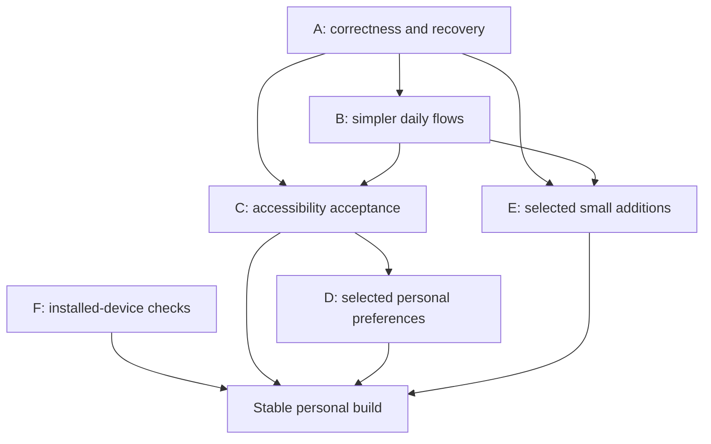

# GasFinder final roadmap

**Updated:** October 15, 2026 · **Audited baseline:** `b7c27a3` · **Scope:** a private personal app; no App Store launch.

This is the single current backlog. It replaces the earlier milestone plan, preserved in [roadmap history](docs/ROADMAP_HISTORY.md). The [final audit](docs/APP_AUDIT_FINAL.md) records evidence, reproduction details and limitations. [Flowcharts](docs/APP_FLOWS.md) describe the intended journeys.

## 1. What “finished” means

A dependable app for four daily questions:

- **Account:** What can I spend after my set-asides, and how current is that estimate?
- **Goals:** How do I assign or release savings without moving bank money?
- **Subscriptions:** What renews next, and what still needs cancellation follow-up?
- **Gas:** Where can I refuel, which prices are known, and does the planned drive fit my estimated range?

The final phase is correctness, simpler flows, accessibility and a small set of personal preferences. New bank feeds, public gas services, cloud sync and extra financial products are outside this finish line.

### Keep these decisions

- Four main tabs; one universal Settings destination with subsections. Keep setup/diagnostics off the main Settings list.
- Keep the requested Leaflet/OpenStreetMap map, prices/N/A/Old labels, List fallback, and report/trip actions below the map.
- Prominent available-to-spend estimate; smaller bank snapshot with explicit reveal and date. Always distinguish unknown from zero.
- Newest-first readable transactions, red/negative spending and green/positive deposits, with text/signs so color is not the only cue.
- One simple file entry: Choose bank PDF or CSV plus Saved imports. Review/balance choice comes after choosing a file.
- Explicit consent to replace a balance; reimports and matching must not create duplicate charges or savings. Equal real purchases stay distinct by default.
- Samples remain opt-in, clearly labeled and excluded from real costs/reminders/evidence.
- Savings are local assignments, not transfers. Planning to cancel is not provider cancellation. Checkout pause is limited browser support, not a card freeze.
- Device-local personal records; encrypted portable backups. Preserve bundle identity, data and existing shortcut links.

## 2. Current baseline: already implemented

These are maintenance/acceptance responsibilities, not features to build again.

| Area | Existing implementation | Remaining responsibility |
| --- | --- | --- |
| Settings | Nine category rows and separate subsection screens; multi-confirmation wipe in Data & backups and Backup | Improve destinations/copy, success feedback and accessibility |
| Account | Confirmed snapshot, newer-activity estimate, set-aside subtraction, explanation, pending exclusion, corrections/aliases/notes | Fix review consistency and edge cases below; prove real statements |
| History/imports | Unified history, filters, hide/Undo, original archive/Trash/relink/export, reconciliation, source evidence, batch/folder review | Reach all records, validate dates, improve batch/draft handling |
| Recovery/privacy | Encrypted backup/restore, durable recovery/Undo, reset/switch, app lock, preview protection, interrupted erasure marker | Installed-device acceptance, attachment preflight and completion reporting |
| Goals | One active goal, direct savings sheet, rule/target/date editing, archive/delete, suggestions | Draft/focus/large-text acceptance and simpler wording |
| Subscriptions | Costs/calendar, samples, bank evidence/alerts, billing/app destinations, cancellation follow-ups, local reminders | Monthly-day selector, contextual links, native permission/delivery checks |
| Gas/cars | GPS/manual area, favorites/cache, price qualifiers/freshness, combined refill/photo/OCR review, statistics | Shorter common flow, accessible alternatives, device/offline quality |
| Drives | Saved destinations, selected car/fuel, stop changes/preferences, routed-leg verification and Maps handoff | Progressive disclosure and real road/Maps acceptance |
| Convenience | Amazon lookup/share/recheck, Safari and desktop Chrome package/override, account/goal widgets behind capabilities | Real source/browser checks and honest capability-specific setup |
| Delivery | Private build profiles and a previous clean iOS simulator build | Installed standalone Release and upgrade/recovery proof |

**Audit verification:** 259 logic tests passed at the audit checkpoint; the first correctness batch now passes 273. Lint and TypeScript also passed during this documentation batch. Previous native build success is historical evidence, not a new phone test. Browser/code checks cannot close phone-only gates.

## 3. Priority and evidence rules

- **P0 gate:** necessary before trusting a stable installation or recovery. No new P0 data-loss defect was reproduced in this audit.
- **P1 fix:** a correctness, accessibility or core-task problem.
- **P2 finish:** worthwhile convenience or clarity after the relevant P1 work.
- **Optional:** excluded from the core completion requirement until chosen.

**S/M/L** mean contained / several connected components / migration or native integration. They are relative scope, not delivery dates. “Observed” means reproduced in the browser; “Source” means established by current code; “Proposal” is an improvement; “Device” requires installed-device testing. Never promote a suspected risk into a confirmed bug without evidence.

**R01–R05 are implemented and locally verified** in the first correctness batch: 273 tests, lint, TypeScript, all-platform JS exports, and synthetic restart/Undo checks pass. See [batch details](docs/ACCOUNT_REVIEW_FIXES.md). R06–R34 remain open/planned, with preferences/additions still optional as described. Implemented work is not an open feature ticket just because phone acceptance remains.

## 4. Batch A — Correctness and recovery

R01–R05 are complete locally; R06–R08 are next. Existing financial journals and portable backups are the foundation; use additive migrations and retain original evidence.

| ID | Priority / size / evidence | Change | Acceptance |
| --- | --- | --- | --- |
| **R01** | P1 / M / Observed | Persist “Keep both” and “Different purchases” review decisions, including deliberate dismissal and Undo | Two equal real purchases stop resurfacing after restart/reimport; genuinely changed evidence can reopen review; neither charge is merged by default |
| **R02** | P1 / M / Source | Use corrected directions/effective signed amounts in match suggestions, display and save-time validation | A corrected deposit cannot link as outgoing spending; corrected withdrawals can match; original raw rows and earlier corrections remain traceable |
| **R03** | P1 / S / Source + probe | Allow signed manual bank balances through a dedicated parser/setter | Enter −$12.34, zero and positive balances; availability and savings limits agree; purchase/goal inputs still reject negative values |
| **R04** | P1 / S / Source + probe | Share strict calendar validation across history/Insights/forms | Feb 30, invalid leap days and reversed ranges are rejected; valid dates retain source-day/time-zone semantics |
| **R05** | P1 / M / Source | Page/search all review, hidden-row and decision history; expose counts and full Undo access | With 250 synthetic candidates/hidden rows and more than 30 decisions, every supported action remains reachable without incorrect merges |
| **R06** | P1 / M / Source | Protect changed drafts from accidental dismissal; provide explicit resume/discard for long imports/reports | Untouched forms close directly; changed forms offer Keep editing/Discard; interruption retains committed files and gives an honest draft outcome |
| **R07** | P1 / M / Source | Resolve the batch's one balance decision before its first save | CSV-first and newest-PDF-last batches behave predictably; use/keep choice is explicit, dated and fixed before commits; no balance is guessed from filenames |
| **R08** | P1 / S–M / Source + Device | Visible reset/restore/wipe completion and cleanup acceptance | Data-screen wipe ends with an accurate completion notice; cancel at each gate keeps records; disposable interrupted-wipe tests finish cleanup; external copies/device lock scope is explicit |

**Regression set:** unchanged/renamed/overlapping PDFs; same amount twice; manual/Wallet-to-bank link; effective direction changes; pending→posted; reimport over reviewed corrections; hidden rows; negative balance; save failure and restart. Preserve set-aside contributions unless the user explicitly adjusts them.

**Dependency:** take and restore a synthetic backup before schema changes. R31 can run alongside this batch and blocks declaring the personal build stable.

## 5. Batch B — Clearer daily flows

| ID | Priority / size / evidence | Change | Acceptance |
| --- | --- | --- | --- |
| **R09** | P1 / S / Observed + Source | Update language and contextual Settings links | “Manage test mode” opens Settings → Subscriptions; quick actions are labeled optional; statement sharing, Wallet capture and launcher shortcuts are clearly distinct |
| **R10** | P1 / M / Source | Separate Hide, Delete, Exclude duplicate, Trash, Reset and Wipe actions | Each action names what changes and where recovery lives; Hide never implies deleting evidence; hidden-history management is discoverable even with no match badge |
| **R11** | P1 / M / Observed | Replace the fabricated monthly calendar date with a day-of-month selector | The visual and spoken value both say “Day N each month”; yearly/trial dates use appropriate controls; month-end/leap-day behavior stays correct |
| **R12** | P2 / M / Proposal | Shorten report/refill and drive setup through disclosure | A mapped pump-price report needs only its essential fields; receipt/Account details are optional; basic trip planning precedes advanced refill/economics controls |
| **R13** | P2 / S / Source | Make budget/range comparisons valid | Monthly percentage shown only for a clearly identified monthly budget period; incomplete coverage stays visible; remaining/over values trace to selected records |
| **R14** | P2 / M / Source | Open related records directly | A fuel report opens/highlights its exact Account charge and returns to the report; review/Undo rows identify merchant/date/amount rather than indistinguishable buttons |

### Copy and action rules

- Use **Saved bank balance**, **Estimated available**, **Set aside**, **Unassigned savings**, **Hidden history**, **Original file** and **Optional quick actions** consistently.
- Distinguish saved preferences from staged form changes. Instant-save controls should say they save immediately; multi-field edits use Save/Cancel.
- One primary action per form step. Put validation beside the field and a concise summary before financial changes.
- Main pages show the next useful action. Setup instructions, technical capability text and raw bank evidence remain available in contextual details.
- Add navigation links to the correct Settings subsection; keep the root list short. Existing four-tab navigation should not accumulate redundant Settings copies.

## 6. Batch C — Accessibility as a completion gate

Accessibility work should accompany Batch A/B components, not wait until the end.

| ID | Priority / size / evidence | Change | Acceptance |
| --- | --- | --- | --- |
| **R15** | P1 / M / Measured | Accessible foreground/background and meaningful control-boundary tokens | Small muted-on-paper text passes the chosen normal-text target; errors/selections/input boundaries remain distinguishable in every supported theme |
| **R16** | P1 / M / Measured | Adequate hit regions for calendars, station links and compact actions | Aim for at least 44×44 native points for standalone actions, with adequate spacing; the 320 px date layout avoids tiny adjacent cells |
| **R17** | P1 / M / Observed + Device | Headings, labels/state, error/status announcements and modal focus | No empty navigation headings; important titles have roles; focus enters/leaves sheets predictably; validation is announced once and returns focus usefully |
| **R18** | P1 / M / Device | Large text and narrow-screen reflow | Core flows work at 320/390 px, 200% web text, and iPhone accessibility text sizes; amounts stay complete, buttons wrap and keyboard does not hide Save/Cancel |
| **R19** | P1 / M / Source + Device | Equivalent text/list access for maps and charts | Find/select/open a station without dragging a map; price history offers readable dated rows; transaction direction includes words/signs, not color alone |
| **R20** | P2 / M / Device | Reduce Motion and keyboard/focus operation | Respect OS reduced-motion preference; no keyboard trap; visible focus and logical order through calendars, maps' List fallback, dialogs and wipe gates |

Measured baseline: small muted text on paper **4.33:1**; on surface **4.88:1**. A calendar day was **46.28×42 px at 390 px**, **36.28×42 px at 320 px**. These browser measurements identify fixes; they do not replace native measurement.

Use [WCAG 2.2](https://www.w3.org/WAI/WCAG22/quickref/) for web contrast, labels, resizing, keyboard and focus checks, plus [Apple accessibility guidance](https://developer.apple.com/design/human-interface-guidelines/accessibility) for native interaction. These are acceptance references, not a certification claim. Implementation must use SDK-compatible APIs.

### Required accessible journeys

1. Import a supported statement, hear the reconciliation/balance choice, save and find its transactions.
2. Reveal a balance, inspect the explanation, correct a transaction and Undo.
3. Create/edit a goal and adjust savings with preview and Cancel.
4. Add a subscription, choose its recurrence, start a cancellation plan and record follow-up.
5. Search a gas area without GPS, choose a list station and report a price.
6. Back up, inspect a restore, cancel it, and navigate the wipe confirmations without erasing.

## 7. Batch D — Simple personal preferences

These are optional preferences within the finish phase, not prerequisites to correct accounting. Use the existing settings store/migration rather than parallel preferences. Defaults preserve current behavior.

| ID | Priority / size | Preference and location | Scope / acceptance |
| --- | --- | --- | --- |
| **R21** | P2 / M | Appearance → System / Light / Dark; optional stronger contrast | Shared semantic theme tokens first (R15); every main form/map overlay remains legible; no custom color editor |
| **R22** | P2 / S | General → Start screen | Choose Gas, Goals, Account or Subscriptions; default Gas; incoming share/notification/deep link takes precedence |
| **R23** | P2 / S | Gas and Subscriptions → Remember last view | Persist Map/List and List/Calendar; preserve existing saved fuel/radius/sort settings; active filter summary and Reset filters are obvious |
| **R24** | P2 / M | Subscriptions → Reminder time and lead | Default remains 9 AM/day before; select a small set of leads and an hour; reschedule without duplicates; statement cadence remains separate |
| **R25** | P2 / M | Privacy → Hide amounts on open | Tap to reveal; cover Account, previews and Insights consistently; widget visibility and app lock remain separately understandable; never call this encryption |
| **R26** | P2 / S–M | Transactions → Date presets and optional row density | This month/Last month/Last 30 days/Custom; clear active range; optional density only if R16/R18 targets survive |

Do not add an in-app text-size setting instead of supporting the OS setting. Use system date/number formats where suitable while retaining USD/integer-cents accounting. New currencies/FX, arbitrary theme palettes and configurable navigation builders are outside scope.

## 8. Batch E — Small additions worth finishing

| ID | Priority / size | Change | Acceptance |
| --- | --- | --- | --- |
| **R27** | P2 / M | Data health and backup attachment preflight | Show available/missing originals/photos and estimated size before export; explicitly allow supported partial/records-only backup; show last creation date without claiming an external file was saved; storage counts stay local |
| **R28** | P2 / M | Manual movement conveniences | Optional purchase date and apply-savings-rule choice; optional deposit/refund entry uses reviewed signed model; no second competing logging flow or repeat contribution |
| **R29** | P2 / S–M | Short contextual setup/help | Skippable Account/Gas/Subscriptions checklist; no required automation setup; optional Settings keyword search opens a subsection; hide empty legacy demo entry while retaining old records |
| **R30** | P2 / M | Readable, traceable summaries | Compact category bars or price trend plus table; coverage badge and merchant/category shortcuts; each total opens supporting rows; no invented “money saved” or new dashboard tab |

If a small addition increases the number of steps for the common task, keep it in optional details or omit it.

## 9. Batch F — Installed-device acceptance and maintenance

Begin these gates early. Do not equate code, a simulator build, exports or a single browser walkthrough with phone acceptance.

| ID | Priority / evidence | Gate | Pass condition |
| --- | --- | --- | --- |
| **R31** | P0 gate / Device | Private installation, upgrade and recovery | Release cold launch with computer off; offline local records; same app identity preserves data on update; separate test-install backup/restore and recovery/Undo pass |
| **R32** | P0 gate / Device | Citizens and purchase capture integrity | Correct page-2 spending/page-3 credits/zero-activity statements; date/sign/balance choice and repeat/overlap protection; cold/warm Share/Shortcut, Wallet eligible capture, cancellation/interruption and storage failure preserve expected totals |
| **R33** | P1 gate / Device | Native convenience and privacy | Auth/relock/app-switcher, permission revoke/delivery/time zones, real reviewed OCR, public Amazon fallback and Safari/Chrome coverage/override tested; widgets only where signed capabilities permit |
| **R34** | P1 gate / Measured | Performance and platform boundaries | Measure 10,000 synthetic movements and larger source/report libraries; responsive typing/scrolling and bounded PDF/OCR memory; document actual device metrics; compile/test Android native OCR if Android is used |

### Scope of acceptance

- Use synthetic data or explicitly authorized redacted files. Never commit personal bank files, original receipts or credentials.
- Test multiple confirmations on disposable data; permanent deletion of the user's actual dataset is not an audit test.
- External browser/provider checks stop before real payment or cancellation. Current platform limits must remain visible.
- Keep the free Apple Personal Team path working. Capability/signing-dependent widgets are optional if the intended installation cannot support them; a disabled feature is not a release blocker when accurately labeled.
- Cloud OTA, bank feeds and shared prices are not required for a bundled personal app. Check current vendor docs before any future service/signing decision.
- Add regression tests for actual risks, not tests that merely reproduce UI implementation. Lint and typecheck every coding batch; targeted device/restore checks follow the affected risk.

## 10. Execution order and dependencies

| Order | Deliverable | IDs | Completion evidence |
| --- | --- | --- | --- |
| 1 | Correct review/math/date behavior | R01–R05 | Synthetic financial regressions, restart/reimport, readable review UI |
| 2 | Draft/batch/recovery completion | R06–R08 | Interrupted-save scenarios and cancel/restore/wipe tests on disposable data |
| 3 | Clear navigation and recurring-date flow | R09–R14 | Main journeys match flowcharts with fewer unnecessary steps |
| 4 | Accessibility across changed and remaining screens | R15–R20 | Screen-reader, large-text, contrast, touch and keyboard matrix |
| 5 | Selected preferences | R21–R26 | Defaults preserved, restart persistence, no accounting change |
| 6 | Selected small finishing features | R27–R30 | Demonstrable time saved; no duplicate entry or misleading summary |
| Parallel / final gate | Real personal build acceptance | R31–R34 | Device/build/OS/date/expected/actual recorded; stable label only after required gates |

Phone checks can run alongside local work. R15 supports R21; R04/R11/R16 share date controls; R01/R02/R05 share review state; R06 precedes longer draft workflows; R17/R18 accompany every form. Preference/addition tickets may be explicitly deferred without reopening the correctness finish line.

## 11. Final release checklist

- [ ] No open reproduced correctness defect in R01–R08 for the supported personal workflow.
- [ ] Ordinary tasks have one clear route, explicit save/cancel boundaries and accessible validation.
- [ ] Remaining labels do not promise live bank sync, automatic Citizens downloads, universal installed-app enumeration, automatic cancellation or universal payment prevention.
- [ ] Core tasks pass VoiceOver, large text and adequate touch-target checks on the personal phone.
- [ ] R31/R32 pass; R33 capabilities are tested or clearly unavailable; R34 has a measured baseline.
- [ ] A current encrypted backup restores on a separate test environment. Original-file/attachment gaps are understood.
- [ ] Latest lint/typecheck/relevant tests pass; private build/version and rollback instructions are documented.
- [ ] This backlog marks completed work once, with evidence. Historical checklists cannot override current status.

Once these conditions hold, use the app and fix observed issues. A “final roadmap” should have a stopping point.

## 12. Explicitly deferred

| Candidate | Reopen only when |
| --- | --- |
| Multiple simultaneous bank accounts / active goals | A specific daily need justifies allocation/transfer and migration complexity |
| Additional banks, credit cards or currencies | Actual supported sample layouts and a separate liability/FX model are available |
| Bank feeds / automatic Citizens downloads | A supported authorized integration is chosen; do not store bank login credentials or automate around authentication |
| Cloud/multi-device sync, public gas prices, background alerts | There is a chosen service, privacy/conflict model and acceptable operating cost |
| Product images / persistent price alerts | Reliable sourcing makes them useful without background scraping or access bypass |
| Replacement Live Activity, live trip tracking, EV support | A defined recurring use case and platform/data feasibility pass |
| OTA infrastructure / paid signing | Deliberate private-distribution choice after installed-build acceptance; no automatic service enrollment |
| App Store publication, ads, monetization, investing or money movement | Outside the present personal-app scope |

## Supporting documents

- [First correctness batch — R01–R05](docs/ACCOUNT_REVIEW_FIXES.md)
- [Final audit and evidence](docs/APP_AUDIT_FINAL.md)
- [Flowcharts and proposed Settings map](docs/APP_FLOWS.md)
- [Implemented local feature details](docs/LOCAL_FEATURES.md)
- [Private builds](docs/PRIVATE_BUILDS.md)
- [Physical-phone checklist — historical steps need the current roadmap's corrections](docs/PHONE_SMOKE_TEST.md)
- [Project handoff](docs/PROJECT_HANDOFF.md)
- [Previous roadmap](docs/ROADMAP_HISTORY.md)
