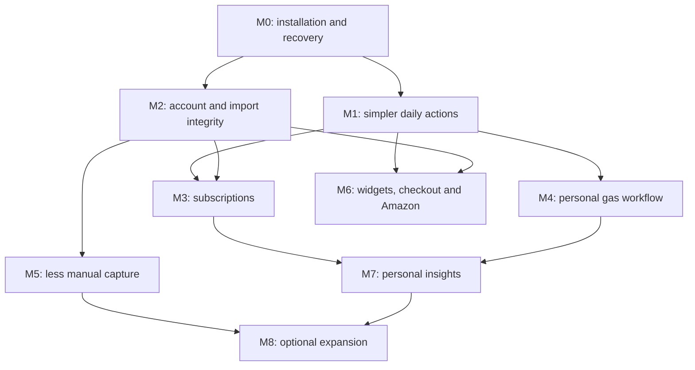

# GasFinder future roadmap

**Updated:** October 14, 2026

**Baseline:** `a9de911` data foundations, `e9beeea` daily actions, followed by the October 14 Gas batch below

**Purpose:** a dependable personal app, installed privately; no App Store launch is planned.

This is the main future-work plan. It replaces the earlier prototype roadmap. Feature-specific documents provide implementation detail; dated notes in the handoff record history. Proposed features below are not claims that they already work.

## 1. Product direction

The app should help you answer four questions with little effort:

1. **Account:** How much can I spend after protecting my set-aside money, and what has changed since my last bank balance?
2. **Goals:** What am I saving for, and how do I adjust that money without accidentally changing something else?
3. **Subscriptions:** What will renew, what is it costing me, and where do I go to cancel it?
4. **Gas:** Where should I refuel, what price information can I trust, and will my planned drive need stops?

The intended result is a useful daily companion for one person. Reliability, fewer steps and recoverable data take priority over more dashboards or integrations.

### Decisions to preserve

- Keep the four main tabs: **Gas, Goals, Account, Subs**. Account replaces Pocket in product copy; old route/storage names can remain for compatibility.
- Keep one universal Settings destination with a gear in the upper right of each main page.
- Keep the requested Leaflet/OpenStreetMap map and the price or **N/A** markers. Report a price and Gas on your drive stay below the map.
- Keep the prominent amount as available money after set-asides. Keep the smaller confirmed bank balance behind **Show** and the snapshot date visible.
- Keep purchases and savings adjustments in Transactions, with newest dates first, readable merchant names, red spending and green deposits. Full history stays at the bottom of the preview.
- Keep bank entry simple: **Choose bank PDF or CSV** plus **Saved imports**. Shortcut setup belongs in Settings. Do not restore paste CSV or another import landing page full of options.
- Ask before replacing the saved balance with a PDF closing balance. Importing, renaming and repeated sharing must not create duplicate charges or repeat savings contributions.
- Keep subscription app selection through the supported installed-app picker, with cancellation completed by you in the provider's app or billing page.
- Keep samples available for testing, with explicit sample labels and isolation from ordinary financial summaries.
- Keep browsing possible while supported checkout routes are paused. Do not restore the purchase waiting list or a separate Activity page.
- Store personal financial records locally by default. A set-aside is bookkeeping inside your bank balance; the app does not move money.
- Favor free map/location services and local reports. An optional paid signing account or data service is a separate decision, not assumed approval to spend.

### Success for personal use

- You can open the app away from the development computer, understand its numbers and recover your data after an update or reinstall.
- A supported Citizens statement takes one share handoff, a balance answer and review only when needed.
- A purchase logged in the app and later found on a statement appears once, while two actual equal purchases remain two charges.
- Common actions are direct: add money to a goal, review a renewal, report a gas price and change a search area.
- Missing data or platform limitations produce a useful explanation and a fallback.

## October 15 local implementation status

259 logic tests, lint, TypeScript and all-platform JavaScript exports pass. A clean iOS simulator app build also passed; phone and Android acceptance remain separate.

The local implementation now includes Account explanations/reconciliation/hidden-row recovery, statement coverage/reminders, spending insights/budgets/forecasts/exports, multi-file/folder import review, reviewed scanned-PDF OCR code, Wallet capture outcomes/routine links, edited/routed trip planning, Amazon recheck/share handling, a packaged Chrome companion with timed overrides, recoverable account reset and explicit app-data erasure. Private build profiles and capability notes are included. See [local feature details and acceptance](docs/LOCAL_FEATURES.md).

| Roadmap IDs | Current state |
| --- | --- |
| ACC-01/ACC-02 | Local review, financial projection, explanations, coverage and date fields implemented; legacy unknown-timezone ambiguity and real statement acceptance remain |
| ACC-03 | Backup-first single-account switching/reset implemented; concurrent multiple accounts remains optional |
| IMP-01/IMP-02 | Archive controls, source details, multi-file review and scanned mode implemented; additional bank formats need samples; real OCR/layout acceptance remains |
| AUTO-01/AUTO-02/AUTO-03 | Native folder candidates, batch review, reminders, sanitized purchase handoff outcomes and user-invoked routine links implemented; actual iOS permissions/Wallet trigger acceptance remain |
| GAS-02/GAS-03/GAS-04/INS-02 | Combined reports, reviewed OCR, qualifiers, recent filtering and recorded fuel/car statistics implemented; native recognition and device photo restore acceptance remain |
| DRIVE-01 | Local plan editing, preferences, destinations, partial targets, routed-leg review and detour estimates implemented; real-road/Maps acceptance remains |
| INS-01 | Spending, classifications, budgets, forecast and CSV/text export implemented; charts can be refined from actual use |
| PAUSE-01/PAUSE-02 | Timed override, URL fixtures, honest state explanation and versioned Chrome ZIP/install/update handoff implemented; real browser coverage remains |
| AMZ-01/AMZ-02 | Reviewed existing-goal recheck and product share entry implemented; live-page acceptance remains; images optional |
| DATA-01/DATA-02/REL-02/REL-03 | Backup/privacy code, reset/erasure, build profiles and capability matrix implemented; installed standalone/offline/signing acceptance remains |
| REL-01/WID-01/SUB-03 | Physical-device acceptance remains; widgets require compatible signing |
| REL-04/WID-02/M8 | Optional service/capability decisions, not prerequisites for local personal use |

The baseline table and milestone descriptions below are the original planning reference; the dated progress/status sections supersede their older missing-feature descriptions. Implemented code is not the same as physical-device acceptance.

## 2. Current baseline: keep completed work out of the backlog

“Implemented” means code exists. It does not imply every native phone flow has been verified.

| Area | Implemented today | Main remaining gap |
| --- | --- | --- |
| Account balance | Dated confirmed snapshot, newer-activity estimate, set-aside subtraction, pending exclusion, manual balance capture | More explanation of coverage; stronger handling of reversals, posting changes and time-zone edges |
| Account identity | One linked account, stable namespace across renames, known PDF account guard, access to older histories | Safe switch-account workflow; separate balances only if multiple accounts become useful |
| Transactions | Unified timeline, merchant display names, direction corrections, hiding/undo, source details and purchase matching | Source-linked audit trail, better search/filtering, true data-removal controls distinct from hiding |
| Citizens import | Local text-PDF/CSV parsing, summary reconciliation, page counts, balance question, duplicate prevention, archived originals | Device verification, archive management, batch/folder import, supported-layout expansion |
| Statement handoff | Signed iPhone shortcut and native file opening; optional quick import of matching clean shared PDFs | Cold/warm launch and interrupted-save checks on the installed phone; simpler repeat setup |
| Goals | One active goal, deadlines/rules, assignments, direct shared money sheet, separate editor, named goal actions and universal preferences | Physical-phone keyboard/accessibility checks; optional setup checklist and appearance polish |
| Subscriptions | Renewal banner, persistent snoozes, explicit sample mode, app picker, bank evidence/alerts and reminder permission/schedule status | Device permission/delivery checks, upcoming-cost summaries and billing destinations |
| Gas | Free station discovery, manual/search-this-area center, recent areas/saved stations, dated result cache, adjacent controls, compact cars and existing price freshness | Physical-phone/offline acceptance, reporting consolidation and useful personal price coverage |
| Cars and drives | Saved cars, editable MPG/capacity estimates, successive stops and Maps handoff | Better road-access/detour evidence, range calibration and saved trip conveniences |
| Amazon goals | Public direct/short-link name and USD price lookup, editable draft, provenance and fallback | Successful live extraction on the phone; optional image/share convenience |
| Checkout pause | Safari extension, desktop Chrome source/package builder, recognized checkout URL interruption | Real browser coverage tests, easy desktop handoff and honest pause-state reporting |
| Widgets | Account/goal widget code and native capability configuration | Enrolled-team signing and device verification for current integration; no active replacement Live Activity |
| Data and delivery | Local persisted stores, original-import archive, versioned migrations, development builds | Complete backup/restore, app lock/encryption decisions, private standalone builds and update recovery |

The current batch reports **223 passing logic tests**, passing lint/TypeScript and successful iOS/Android/web exports. These are development checks, not a substitute for physical-device acceptance. See [current handoff](docs/PROJECT_HANDOFF.md), [app audit](docs/APP_REVIEW.md) and [phone checks](docs/PHONE_SMOKE_TEST.md).

### October 15 fuel implementation progress

- GAS-02/GAS-04: combined station/price/refill form, optional photos, explicit Account linking/logging, cash/card/member qualifiers, recoverable report Trash, recent-price filtering and persistent web photos are implemented.
- INS-02/DRIVE-01: recorded per-car fuel cost/gallons and conservative full-fill MPG intervals are implemented. Detour/road-access planning remains open.
- GAS-03: local Vision/ML Kit module and reviewed field suggestions are implemented; native compilation and real-receipt accuracy remain unverified. Scanned bank PDFs are separate.
- Photo backups cover both legacy price reports and receipts; restore/Undo remount forms. See [Fuel reports](docs/FUEL_REPORTS.md). 244 logic tests, lint and TypeScript pass.

### October 14 core implementation progress

- DATA-01: encrypted versioned portable backups, optional original/photo attachments, authenticated validation, staged restore, durable rollback, startup recovery and Undo restore are implemented. Synthetic browser export/restore/reload/undo passed. Native cross-install/file-sharing acceptance remains open.
- DATA-02: optional OS authentication, configurable relock delay and app-switcher protection are implemented with device-only preferences. Physical-device authentication and snapshot acceptance remain open; AsyncStorage is not encrypted by the app lock.
- IMP-01/IMP-02: Saved imports now supports rename, search/sort, size/period display, recoverable Trash, same-original relinking, bulk ZIP export, source transaction links and a persistent latest import outcome. Citizens/CSV file and ledger changes now share a recoverable journal. Batch review and scanned statement OCR remain open.
- ACC-01/ACC-02: raw evidence stays intact while merchant aliases, categories, transfer/refund/reversal annotations, notes and correction history/Undo are stored separately. Full history includes date/category/source/file filters. Time-zone/source-calendar-date migration and broader match review remain open.
- Verification for this milestone: 232 logic tests, lint, TypeScript and iOS/Android/web JS exports pass. Native builds and the remaining roadmap milestones are not marked complete by these exports.

### October 14 subscription implementation progress

- SUB-01: real active 7/30-day costs, annual run rate/monthly equivalent, list/calendar views, optional trial end dates and categories are implemented. Bank schedule review requires three newer posted charges, tolerates short posting delays and requires an explicit edit/save.
- SUB-02: billing channel selection, checked Apple/Google/Spotify/Netflix starting points, associated-app fallbacks, persistent cancellation due dates, future phone follow-ups, canceled-on confirmation/history and possible-refund context are implemented. Older plans migrate without changing record IDs or amounts. Provider sign-in/native handoff acceptance remains open; custom cadence remains conditional on a concrete need.
- Acceptance: synthetic sample trial/category/billing edits, calendar date filtering and explicit cancellation were checked in the browser. Costs retained the real subscription total while samples changed. 239 logic tests, lint, TypeScript and all-platform JS exports pass. Phone notification delivery remains a physical-device gate.

### October 14 implementation progress

**UX-04 / GAS-01:** Gas now shows area/GPS/error state and Filters above the retained map, accepts submitted city/ZIP/address or coordinates without GPS permission, and offers explicit Search this area after panning. Recent areas, station favorites and dated OpenStreetMap result snapshots persist locally. Cached results keep price ages and report partial coverage; late GPS results cannot overwrite a manual choice. My cars is compact, with selection in Manage/trip planning. See [Gas area search](docs/GAS_AREA_SEARCH.md) for service limits, cache behavior and remaining physical-device checks. Financial records, native capabilities and dependencies are unchanged.

### October 13 implementation progress

- **UX-01:** direct Add money / Adjust savings and Account → Manage savings share one preview sheet. Goal edits have a separate Save/Cancel boundary. Purchases use Transactions.
- **UX-02 core cleanup:** one universal gear, global suggestion/widget controls in Settings, inline Goal actions for archive/delete, and preserved Legacy demo records in Settings → Data. The optional setup checklist and appearance work remain planned.
- **UX-03:** fresh installs start in normal mode; existing requested samples retain explicit test mode. Samples are excluded from phone notifications and bank evidence. Renewal banners can snooze for two hours or through local midnight, persist across restart, and show their return time.
- **SUB-03:** Settings reads phone permission and actual scheduled reminder counts, offers retry/phone settings, and refreshes after foregrounding. Physical-phone permission, scheduling/delivery and time-zone checks remain open.

Subscription persistence version 5 only adds sample visibility and renewal snooze preferences; existing financial records and decisions are preserved. No native capability or dependency changed. M0 backup/restore and private bundled installation remain unfinished.

## 3. Priorities, effort and sequence

- **P0:** data loss, incorrect balances/duplicates, an unusable installed app, or a broken core handoff.
- **P1:** a main daily task that is confusing, repetitive or unnecessarily difficult.
- **P2:** useful convenience, better insight or broader coverage after the foundations work.
- **Optional:** a new cost, infrastructure commitment or change in personal-use scope.

Effort is relative: **S** = contained change; **M** = one feature across UI/state/tests; **L** = migration, native integration or several connected workflows; **Spike** = resolve feasibility before estimating implementation. These are not promised dates. Ship one coherent batch at a time; do not begin every workstream together.

| Milestone | Outcome | Main work | Priority / size | Completion gate |
| --- | --- | --- | --- | --- |
| M0 — Dependable personal installation | The installed app and your data survive ordinary use | Device smoke tests, versioned backup/restore, a private bundled build and update plan | P0 / L | Cold launch without Metro; restore and repeat import preserve totals |
| M1 — Simpler daily actions | Core tasks stop hiding behind unrelated screens | Goal money controls, universal settings, samples/snooze, Gas layout | P1 / M | Main tasks work at small width with clear save/cancel behavior |
| M2 — Complete account workflow | Each displayed amount can be traced and corrected | Canonical transaction model, import history/archives, bank coverage and automation polish | P0–P1 / L | Duplicate/reversal/balance scenarios reconcile and failed saves recover |
| M3 — Useful subscriptions | Renewals and cancellation follow-through require less work | Cost summaries, billing destinations, alert review and reminder permission state | P1 / M | Real subscriptions stay distinct from samples; review and reminders persist |
| M4 — Useful personal gas data | Nearby and route results work with or without GPS | Manual search, favorites, one report flow, reviewed receipt OCR, route improvements | P1–P2 / L | A real refuel can become a linked price/receipt without repeated entry |
| M5 — Less manual capture | Repeated imports and eligible purchases become easier | Folder/batch statements, Wallet setup/health, scheduled user prompts | P1–P2 / M–L | No unseen duplicates, silent balance replacement or false automation status |
| M6 — Convenience surfaces | Proven core data appears where it is useful | Widgets, checkout coverage/package handoff, reliable Amazon lookup/share | P2 / M–L | Each supported surface is verified on its actual device/browser |
| M7 — Personal insights | Trends explain decisions without inventing savings | Spending/subscription/fuel summaries, optional simple budgets and forecasts | P2 / M | Every figure traces to records and states its assumptions |
| M8 — Optional expansion | Add only integrations you will actually use | Multiple accounts/goals, private sync, external data or richer trip support | Optional / Spike–L | Explicit need, tested data ownership and acceptable ongoing cost |

M0 device checks and M1 reversible UI cleanup can proceed together. Backup/recovery must be available before storage migrations, destructive data tools or account switching. Widget signing is an independent gate; it should not hold up account, subscription or gas improvements.

## 4. M0 — Installation, recovery and data protection

### REL-01 · Finish the native acceptance pass · P0 / M

Use the current iPhone as the primary device. Keep Android builds compatible and test them when an Android device is available; browser previews support development but cannot prove native behavior.

- Test Citizens Share/Download and the shortcut with the app closed, open and backgrounded; both balance choices; old/repeated/no-activity PDFs; warnings and account mismatches.
- Test real Wallet automation setup and an eligible purchase; repeat the handoff without another charge/contribution.
- Test reboot, offline launch, file-picker cancellation, interrupted archive writes, large PDFs, keyboard movement, safe areas and accessibility text.
- Verify subscription app launching, notification permission changes, native map gestures and Maps trip handoff.
- Record build/OS, outcome and remaining limitations in one short verification log. Browser/module simulation must not be labeled native verification.

**Done when:** each supported core task works on the installed phone, failures retain recoverable drafts, and remaining optional capability gates are visible in Settings.

### DATA-01 · Complete portable backup and restore · P0 / L

Add Settings → Data → Back up / Restore. Start with a complete versioned backup, not cloud synchronization.

- Include linked account identity/namespace, balance snapshots and baseline IDs, transactions, purchase links/import keys, corrections/hidden rows, set-asides, goals/archives/rules, subscriptions/reviews/dismissals, cars, reports and preferences.
- Offer original PDFs/CSVs and receipt photos as an attachment option; show size/counts. A records-only backup must clearly say originals/photos are excluded.
- Use an encrypted portable backup for financial records and attachments, with established cryptography and a recovery/password design. Keep portable backup recovery separate from a key tied only to the current device.
- Restore into temporary storage, validate schema and file checksums, show counts and affected data, then explicitly replace app data. Keep a rollback copy until the restored state passes validation. Merging two backups is later work.
- Reject corrupted/newer unsupported backups and wrong passwords without altering existing records. Re-importing a statement after restore must still deduplicate.
- Preserve reminder preference as an intention, but recheck device permission and reschedule only under the applicable user settings. Do not restore another device's permission or capability detection as fact.
- Save through the system file/share flow so you can choose Files/iCloud Drive or another destination. Remind about backups in-app; do not silently upload originals.

**Done when:** a backup restored into a separate test installation reproduces balances, links, goals, subscription choices and selected attachments; a failed restore leaves the previous installation intact.

### DATA-02 · Privacy controls and local storage · P1 / M; migration L if justified

- Add optional biometric/passcode app lock, configurable relock timing and a privacy screen in the app switcher. Widget amounts remain separately opt-in.
- Explain where originals/photos live, what is exported and how to delete app-owned data. Separate financial-data deletion from deleting a source file or hiding a timeline row.
- Keep bank text, account identifiers, exact locations, filenames and receipt details out of ordinary logs, crash reports and screenshots committed to Git.
- Review OS file protection and temporary-file cleanup. An app lock alone does not encrypt stored records.
- Keep the current Zustand storage while it is sufficient. Introduce a repository layer first; evaluate SQLite for atomic writes, query performance and audit history when measurements/data needs justify migration.
- Evaluate native SQLCipher encryption and key storage as a deliberate migration; do not store a complete ledger in a small secret store. Web storage needs its own tested strategy. Expo documents native SQLCipher support and cautions that SQLite web support is alpha. [SQLite SDK 57](https://docs.expo.dev/versions/v57.0.0/sdk/sqlite/), [SecureStore SDK 57](https://docs.expo.dev/versions/v57.0.0/sdk/securestore/).

**Done when:** locking/privacy states are honest, deletion targets are explicit, recovery works, and any storage migration retains all source identities and accounting totals.

### REL-02 · Private builds and updates · P0 / M

Build a personal-use installation process; details are in section 13. Keep the same bundle/application ID across compatible updates to preserve data, and back up before changing signing identity, native capabilities or storage. Display app/build/runtime version in Settings and keep a known-good build available.

## 5. M1 — Simplify the daily interface

### UX-01 · Direct goal money actions · P1 / M

**Status:** implemented; mobile-width preview/save/cancel and accounting-limit checks pass. Native keyboard/accessibility checks remain in REL-01.

- Add **Add money** and **Adjust savings** outside Edit goal. Choose the destination explicitly: active goal or unassigned set-aside.
- Keep Edit goal for name, target, deadline and rule. Editing a draft and performing an immediate accounting action must not share an ambiguous Save/Cancel boundary.
- Reuse one purchase-logging form from Transactions and any deliberate shortcut entry points.
- Show available money and the exact expected set-aside change before confirmation. Lowering a goal's savings and deleting the goal are different actions.
- Preserve saved contributions when editing/deleting a purchase unless an explicit separate adjustment is chosen.

**Done when:** common contribution/adjustment tasks take no more than two actions to reach their form, Cancel has predictable behavior, and no new form bypasses balance/rule limits.

### UX-02 · Universal settings and consistent names · P1 / S–M

**Status:** the core cleanup is implemented. Optional setup checklist, appearance and broader shared-component polish remain planned.

- Remove the extra Goals gear; move global suggestion/widget preferences into universal Settings.
- Use a named goal menu for finish/archive/delete. Keep goal-specific rule controls in the goal editor.
- Make the tab and page title agree on Goals. Move read-only investing/demo history to Settings → Data → Legacy records without deleting it.
- Reuse shared buttons, validation messages, sheets and destructive confirmation patterns. Preserve inline subscription deletion confirmation.
- Add an optional short setup checklist: first statement, first goal, optional car, optional reminders/automation. Completed or skipped items stay dismissed.
- Add dark mode and broader appearance polish after the shared components are consistent; respect system accessibility settings throughout.

**Done when:** each main page has one gear, no duplicate primary import/log-purchase actions appear, and equivalent actions have consistent labels and behavior.

### UX-03 · Samples and renewal interruptions · P1 / M

**Status:** implemented for in-app reviews. Snoozes apply to the renewal banner; enabled real-subscription phone reminders keep their 9 AM schedule. Device restart/foreground acceptance remains in REL-01.

- Introduce explicit **Test subscriptions** mode in Settings. Samples remain editable/resettable and clearly labeled.
- Exclude sample costs, bank alerts and phone reminders from normal mode. In test mode show which behaviors are simulated.
- Replace repeated full-screen interruption with a renewal banner/list that opens review. Persist a snooze until tomorrow, a chosen time, or the next relevant renewal.
- Keep Keep / Plan to cancel / I canceled it distinct. Foregrounding, navigation and restart must not reset the snooze.

**Done when:** samples can still exercise the feature, while normal use is not repeatedly interrupted by invented renewals.

### UX-04 · Gas controls where they are needed · P1 / S–M

**Status:** implemented and checked at 390/320 px. Native keyboard, safe-area, large-text and map-gesture acceptance remain in REL-01.

- Show location/search state above the map, with fuel/radius/price-only controls adjacent to it.
- Compact My cars into selected car + Manage; expand vehicle details only when planning or editing.
- Show useful loading, denied-location, empty-price and offline states in the first viewport.
- Preserve map/list selection, report/trip actions below the map and the requested map style.

**Done when:** the initial screen explains why there are no results and provides a working next action without scrolling past unrelated cards.

## 6. M2 — Account, ledger and import completeness

### ACC-01 · One authoritative record model · P0 / L

The UI currently combines bank movements, local purchases and savings entries. Consolidate their relationship through a transaction repository before adding more ways to ingest data.

- Keep raw imported evidence immutable. Store corrected direction, merchant name/category, matching decisions and visibility separately.
- Record stable transaction/account/source IDs, source-file/page references, transaction date, posting date when known, status and relationship to a local purchase. Preserve all existing IDs/aliases during migration.
- Represent refunds, reversals and transfers explicitly when evidence allows. An incoming transfer is a bank credit but is not income earned or avoided spending.
- Keep confirmed bank snapshots separate from estimates. Every estimate should explain which newer movements it includes, pending exclusions and missing coverage.
- Handle pending-to-posted changes, changed descriptions, overlapping files, one-to-one app matches and repeated equal charges. Ambiguous matches get review, not automatic deletion.
- Track source calendar dates separately from artificial noon timestamps; test daylight saving, time-zone changes and same-day manual checks.
- Make import records, purchase links and any chosen contributions one recoverable commit. A crash between archiving the original and committing records must be detectable and retryable.

**Done when:** no listed ingestion/correction/reversal scenario silently duplicates money or contributions, and the same calculator serves Account, rule caps, summaries and widgets.

### ACC-02 · Explain freshness and coverage · P1 / M

- Show last successful statement period/import and which period remains uncovered. Add a gentle statement reminder, based on a configurable cadence rather than claiming Citizens has a new PDF.
- Offer **Why this amount?**: confirmed balance, newer deposits/spending, pending exclusions and set-asides.
- Add user-controlled merchant aliases and categories without changing duplicate identity.
- Expand full-history filters with date range, merchant/category and source. Preserve source descriptions in details/search and the bottom full-history entry point.
- Explain **Remove from history** as hiding. Put permanent app-record removal/reset in Data with its impact on estimates, duplicates and future reimports shown before confirmation; offer recovery where practical.
- Add reconciliation review for uncertain matches and corrections, with an audit history and an undo path.

**Done when:** you can trace a balance, understand missing activity and correct a displayed transaction without rewriting its bank evidence.

### IMP-01 · Archive management · P1 / M

- Add rename, search/sort, statement-period display, file size, reconciliation status and import outcome to Saved imports.
- Open the original from transaction details and the transactions associated with a saved import.
- Support deleting an archived original independently of imported records; say that explicitly. Offer recoverable trash or export before permanent removal.
- Detect missing/corrupt originals and provide reselect/relink recovery without another financial import.
- Bulk export selected originals. Preserve content-based duplicate protection even if filenames change.

**Done when:** originals are easy to find/manage and no file-only action unexpectedly removes transactions, savings or subscription evidence.

### IMP-02 · Broader import support · P1–P2 / M per format; OCR Spike/L

- Finish Citizens layout/version coverage first: wrapped rows, multiple periods, checks, zero activity, mixed debit/credit headings, account masking and totals unavailable/mismatched.
- Add parser/version/source provenance so reprocessing can preview proposed repairs without silently replacing corrected records.
- Add a persistent import report: rows read, excluded reasons, matched charges, totals checks, balance decision and any optional contribution.
- Add batch PDF/CSV review with per-file status and one reviewed balance choice for a clearly identified candidate. Do not assume the last filename is the newest account balance.
- Support additional banks or credit cards only when useful and when sample formats are available. Credit-card debt needs a separate model; do not put it into the checking available-money calculation.
- Treat scanned bank PDF OCR as a separate reviewed mode. OCR must not bypass totals checks or guess ambiguous directions, dates or amounts.

**Done when:** each supported format has meaningful fixtures and acceptance checks; an unsupported or incomplete file remains a review/error, not a fabricated successful import.

### ACC-03 · Account switching and multiple accounts · P2 / M then optional L

- First provide a deliberate switch-account workflow: backup, explanation of existing history/set-asides, explicit account selection and a reviewed opening snapshot.
- Until separate balances exist, keep the known different-account PDF guard.
- Add multiple checking/savings accounts only if needed: per-account snapshots/history, explicit set-aside allocation and internal transfer linking. Never sum two sides of a transfer as new income/spending.
- Credit cards, cash wallets and liabilities remain distinct optional models.

**Done when:** importing a second account cannot overwrite or combine the first account's balance accidentally.

## 7. M3 — Finish subscription management

### SUB-01 · Costs and upcoming renewals · P1 / M

- Show next 7/30 days, monthly equivalent and annual total for real active subscriptions. Clearly distinguish an annual charge from its monthly equivalent.
- Add a calendar/list switch, trial end dates, custom cadence if needed and categories.
- Let you override a bank-estimated renewal date; record actual posting separately. Do not shift the renewal automatically after a weekend posting delay.
- Add billing-date/cadence mismatch review alongside existing price-change alerts, with evidence and a user-confirmed update.
- If forecasting available money after known bills, show it as a separate forecast. A bill is not deducted from the actual estimate until a transaction arrives; a bill reserve must not be counted twice as a set-aside.

**Done when:** totals exclude samples/canceled items, annual costs are understandable and each forecast exposes its assumptions.

### SUB-02 · Cancellation destinations and follow-through · P1 / M

- Add billing channel: Apple, Google Play, provider website or direct provider app. The installed app is not necessarily where the subscription is billed.
- Maintain verified provider-specific billing links/instructions and a website fallback. Update the supported app catalog based on what you use.
- Follow Plan to cancel with a due-date reminder, easy retry/open and explicit I canceled it/date entry. Retain/reactivate intentionally; do not infer cancellation from opening the app.
- Show new charges after a recorded cancellation with posting evidence. Account for later refunds and allow dismissal or correction.
- Preserve the supported installed-app picker; explain when an app is outside its catalog. iOS URL queries are restricted to declared schemes, with a 50-entry limit for apps linked on/after iOS 15. [Apple canOpenURL](https://developer.apple.com/documentation/uikit/uiapplication/canopenurl%28_%3A%29).

**Done when:** each supported cancellation path opens the correct billing starting point, and cancellation status changes only through an explicit user action or reviewed evidence.

### SUB-03 · Reminders reflect phone permission · P1 / M

**Status:** permission/schedule status and refresh/open-settings controls are implemented. Physical-phone permission revocation, notification delivery, duplicate scheduling and time-zone acceptance remain open.

- In Settings distinguish wanted reminders, permission granted, scheduling success and any disabled/error state.
- Recheck on foregrounding and after returning from phone Settings; offer an Open settings action when needed.
- Reschedule after edits, cancellation, restores and time-zone changes without duplicate notifications. Test month ends, leap years and local daylight-saving changes.
- Persist snooze/review decisions. Remove obsolete scheduled reminders when a subscription is removed/canceled.

**Done when:** an enabled switch never silently implies notifications will arrive when the phone has denied permission or scheduling failed.

## 8. M4 — Make gas useful with personal data

### GAS-01 · Search without GPS · P1 / M

**Status:** implemented with submitted Photon place lookup, direct coordinates, explicit map-area search, recent areas, saved stations and dated local result caching. GPS-unavailable/manual selection and restart were checked in the browser. Airplane-mode cold launch and native permission/gesture acceptance remain in REL-01; offline basemap downloads remain out of scope.

- Add city/ZIP/address or explicit map-area search, with a visible search center and distance measured from it.
- Keep current location as an option; permission denial must not strand the search.
- Add **Search this area**, recent search areas and favorite stations. Search only when requested or after a controlled movement, not on every small pan.
- Cache recent station locations/results with timestamps and show cached/offline status. Keep existing service failover and cancellation behavior.
- Offline map downloads are not part of the default public tile service: OSM's tile policy prohibits bulk/prefetch offline downloads. Use an explicitly permitted provider if offline basemaps become a requirement. [OSM tile policy](https://operations.osmfoundation.org/policies/tiles/).

**Done when:** GPS-denied and offline-result flows show honest results or a usable manual fallback without inventing a current location.

### GAS-02 · One report flow · P1 / M

- Combine price and receipt reporting: choose a station, fuel, observed date/time and price; attach a receipt optionally.
- Start from a station pin/card when possible. Search/select the correct station in direct entry; never attach a report by a vague name match alone.
- Preserve edit/delete and price history. Show cash/card/member-only price qualifiers if supported; do not compare discounted/member prices as ordinary pump prices.
- Let a complete fuel purchase optionally link to Account or an existing bank charge after review. The current receipt feature is separate; linking must avoid a second transaction when its statement arrives.
- Check gallons × unit price versus total using an explicit rounding tolerance; retain extra fees/discounts rather than forcing an incorrect equality.

**Done when:** reporting a real refill does not require two overlapping forms and every map price has a deliberate station/fuel/date/source relationship.

### GAS-03 · Reviewed receipt OCR · P2 / Spike → L

- Evaluate on-device recognition first: Apple Vision and Android ML Kit are candidate platform components, not dependencies already selected. Native integration/model availability needs an SDK-compatible spike. [Apple text recognition](https://developer.apple.com/documentation/vision/recognizing-text-in-images), [ML Kit text recognition](https://developers.google.com/ml-kit/vision/text-recognition/v2).
- Prefill station/date/fuel/unit price/gallons/total only when supported by the image. Mark uncertain fields; keep manual input usable.
- Show a review screen before saving. Distinguish unit price from total, discounts, multiple purchases and card/account numbers.
- Avoid collecting payment details; support cropping/redaction and clear photo retention/deletion. Recognition failure must keep the photo/draft recoverable.

**Done when:** a useful real-receipt sample set reduces typing while uncertain arithmetic or missing fields still require correction. Never claim OCR is verified merely because text was returned.

### GAS-04 · Price coverage and quality · P1–P2 / M

- Keep local personal reports as the default. Make favorite-station prices fast to update and show price age on map/list/history.
- Separate latest, recent, old and unknown values consistently across searches, selected markers, routes and comparisons.
- Preserve selected fuel, N/A and hide-unpriced behavior; optionally offer a recent-prices-only filter separately from having any saved price.
- Broader pump-price coverage needs a permitted data source or deliberate shared-report service. OpenStreetMap station locations do not provide universal live prices, and a free complete price feed is not assumed.
- Any shared backend is optional for this personal app; add it only if sharing is useful. It then needs source labels, correction/deletion, input limits, private credentials and an operating-cost decision.

**Done when:** unavailable or old prices cannot masquerade as live bargains, and price coverage limitations are visible.

### DRIVE-01 · Better fuel-stop decisions · P2 / M–L

- Show estimated fuel needed, range assumptions and the remaining safety margin. MPG/tank capacity remain editable estimates.
- Use receipts to suggest measured MPG only with enough compatible full-fill data; do not infer accurate MPG from an isolated partial refill.
- Improve road-access/detour checks using routable approaches where available. Straight-line offset is not proof that an exit/station is reachable.
- Compare estimated fuel savings with the cost of the detour; label assumptions when prices are old/missing.
- Add swap/remove stop, preferred/avoid stations, saved destinations and flexible full/partial-refill planning after the base plan is dependable.
- Keep incomplete-plan warnings and Maps waypoint preservation. Use explicit replan when fuel/destination/stops change.
- Trip tracking/background location and EV charging are optional later projects, each with a new data/permission design.

**Done when:** the app explains its recommendation and does not mark an uncovered leg complete; real routes and Maps handoffs preserve every chosen stop.

## 9. M5 — Reduce repeated capture work

### AUTO-01 · Citizens share and folder workflow · P1 / M–L

- Keep Share → GasFinder Import Statement as the primary path. Show setup health based on an actual received/saved file, not a return from Shortcuts.
- Add an optional Files shortcut: choose a user-owned statement folder, select the newest unimported candidate(s), then send them to the app. Confirm actual iOS Files/Shortcut permissions and behavior before promising background folder watching.
- Use parsed statement period/account identity and content fingerprints rather than filename order. Already processed files remain known even when renamed.
- For batches, review warnings/matches per file and present one clear proposed closing-balance/date choice. A clean shared-file quick import retains the existing explicit balance answer.
- Add a user-scheduled reminder to get a new statement, with a route to the existing setup/download instructions. It cannot tell whether Citizens has produced a statement without an authorized source.
- Do not store bank credentials or automate around bank authentication. Unattended Citizens downloading is outside the current implementation; research an authorized connection only if monthly PDFs prove insufficient.

**Done when:** the shortcut/folder path reduces picking steps and never silently imports the wrong account, repeats a contribution or replaces a newer balance.

### AUTO-02 · Wallet capture and duplicate review · P1 / M

- Consolidate shortcut setup/status in Settings; show last successfully received purchase, not a claim that every card purchase is captured.
- Verify merchant/amount/currency and eligible Transaction-trigger behavior on the actual iPhone.
- Add a small recent import/error log without sensitive payloads; handle malformed/repeated handoffs and app restart.
- Offer review for similar-looking purchases; date/amount alone is not proof of a duplicate.
- Keep manual log and PDF reconciliation as fallbacks for unsupported cards, non-Wallet spending and delayed statements.

**Done when:** supported captures arrive once, reconcile to bank posting once and remain explainable when capture was unavailable.

### AUTO-03 · Optional routines · P2 / S–M

User-invoked shortcuts can later open a gas search, log a purchase, add reviewed goal money, view renewals or begin a backup. Scheduled routines should open a clear action or reminder; they must not perform invisible financial edits. Automating a real transfer is outside scope.

## 10. M6 — Widgets, checkout pause and Amazon convenience

### WID-01 · Finish Account and Goal widgets · P2 / M, signing gate

- First verify the existing Account/Goal widget integration in a compatible signed build.
- Use the same account calculator, snapshot date and goal totals as the app. Keep amount visibility opt-in; explain that widgets can lag and are not a live bank feed.
- Tap through to the appropriate account/goal action. Test gallery sizes, locked-device privacy, disabled amounts, corrections, restore and widget removal.
- Future subscription widgets can show the next real renewal; gas widgets should use a chosen/favorite station rather than silently requesting background location.
- SDK 57's `expo-widgets` supports iOS widgets/Live Activities, requires a development/native build, and uses an App Group for widget data. Android widgets are a separate implementation, not something this package currently provides. [Expo Widgets SDK 57](https://docs.expo.dev/versions/v57.0.0/sdk/widgets/).

**Done when:** displayed numbers and privacy behavior match the app on the actual supported phone, including after an update.

### WID-02 · Choose a useful Live Activity · Optional / Spike → M–L

The old purchase-waiting-list activity is retired. Do not bring the waiting list back to satisfy this item. Evaluate a bounded activity such as a user-started checkout pause countdown or active fuel-stop trip. First establish a reliable data connection to that event; no indefinite “live balance” activity based on monthly PDFs. Handle start/end, stale state, restart and privacy before shipping. Background/push updating is a separate capability decision.

### PAUSE-01 · Verify browsing versus checkout · P1 / M

- Test selected shops on Safari iPhone and desktop Chrome, including checkout redirects, embedded payment requests, expiry, manual Resume, disabled extension and browser restart.
- Keep product browsing/carts available. Provide a controlled override for false positives, with visible supported coverage and remaining gaps.
- Surface **extension installed/enabled** separately from **a pause is active**. The current app/browser storage does not synchronize that state; add active-state reporting only after a feasible bridge is established.
- Maintain a small supported-shop rule catalog and a repeatable update/coverage test. Test without completing a real payment.

**Done when:** selected tested routes pause and ordinary browsing works, with no promise of universal payment prevention.

### PAUSE-02 · Easy private desktop installation · P2 / M

- Provide a ZIP and clear Load unpacked instructions for the built desktop Chrome extension, with version and update steps. It can remain privately installed without a Chrome Web Store release.
- Add a useful handoff from phone setup to the computer, without transmitting bank records.
- Explain phone coverage before setup. Chrome's phone installation instructions use **Add to Desktop**; they do not install this extension in phone Chrome. A phone Chrome blocker is a separate feasibility question. [Chrome extension installation](https://support.google.com/chrome_webstore/answer/2664769?hl=en).

**Done when:** you can install/update the package on the intended computer without finding a development directory, and the phone UI does not imply unsupported coverage.

### AMZ-01 · Prove live Amazon lookup first · P1 / M

- Verify current direct/a.co links on the actual phone: selected product/variant, full USD price, sale price and partial/blocked results.
- Keep manual fallback, cancel/timeout handling and provenance. Tax/shipping can be user-entered target adjustments, not guessed product prices.
- Recheck an existing goal's price only on request, show old/new values and ask before changing its target; never silently reduce saved money.
- Maintain representative extraction fixtures and investigate changed markup without bypassing login/CAPTCHA or access restrictions.

**Done when:** the tested public pages autofill correctly or offer an honest usable fallback; saved targets only change after review.

### AMZ-02 · Share and image convenience · P2 / M

- Accept an explicitly shared product link into the same reviewed goal draft.
- Add a product image only with reliable permitted sourcing and cache/size limits; it is optional decoration, not a prerequisite to a goal.
- Consider a shared-page helper if public lookup consistently fails. Keep it explicit and separate from checkout pause permissions.
- Wish lists, multiple product goals and price alerts depend on multi-goal design and reliable data; they are not a reason to add background scraping now.

## 11. M7 — Personal insights, after the data is trustworthy

### INS-01 · Simple spending and subscription views · P2 / M

- Spending by period/merchant/category, income and transfers separated, real subscription totals and covered-date ranges.
- Optional voluntary category budgets with editable classifications; missing statements produce a coverage warning rather than an apparently complete month.
- Upcoming-bill forecast with chosen assumptions and no double deduction from actual account activity or reserves.
- Show confirmed contributions to goals separately from avoided spending. A paused or skipped purchase is not proven cash saved.
- Export transaction CSV and readable summaries with consistent cents/date semantics, source labels and sample exclusion.

### INS-02 · Fuel and car costs · P2 / M

- Fuel spend, gallons, price history, per-car totals and measured MPG when sufficient data exists.
- Explain whether a chart covers recorded receipts or all known fuel charges; linking receipts to bank charges must not double-count cost.
- Optional reminders for a frequent station's aging price or a chosen refill routine; no background tracking by default.

**Done when:** totals reconcile to the selected underlying rows, forecasts are labeled, and empty/incomplete data is understandable. Start with a few useful charts; do not build a general finance dashboard before these views help you.

## 12. M8 — Optional expansion and explicit boundaries

| Candidate | Build only when | Prerequisite / likely cost |
| --- | --- | --- |
| Multiple active goals | One goal is restrictive in real use | Explicit allocation of set-asides; contributions/refunds cannot count in two goals |
| Multiple checking/savings accounts | You need both balances day to day | ACC-03, per-account baselines, transfer pairing and cross-account rule policy |
| Private multi-device sync | Manual backups are insufficient | Complete restore format, conflict resolution, encryption/key recovery and a chosen private hosting/cloud approach |
| Read-only authorized bank feed | PDFs/Wallet capture cannot supply needed timeliness | Provider availability, access/cost review, explicit account authorization and reconciliation with imported history |
| Shared gas reports or a licensed price feed | Personal reports do not cover useful stations | Permitted sourcing, endpoint limits, correction/deletion, attribution and ongoing operating budget |
| Additional banks, credit cards or currencies | You actually use them | Real sample layouts; separate liability and FX/date/precision models |
| Active trip tracking / EV charging | You need more than manual fuel-stop planning | New permission/battery model and dependable road/charger data |
| Desktop/web companion | Bigger-screen review is useful | Storage portability, authenticated access if hosted, and server deployment for existing web API routes |

Do not include an App Store launch, store screenshots/ASO, advertising, subscriptions to this app, public acquisition analytics, multi-tenant accounts or enterprise distribution in the main plan. TestFlight is not a required milestone. Real transfers, card freezes, custody, brokerage/investing and automatic provider cancellation are outside the present product direction. The earlier roadmap's investing/real-money service tracks are superseded; retain legacy records without expanding those services.

## 13. Personal installation and update strategy

### Choose a path without making publication a dependency

| Path | Intended use | Constraint / decision |
| --- | --- | --- |
| Existing free Apple Personal Team | Continue private iPhone development and short testing cycles | Apple documents seven-day provisioning expiration and rebuild/reinstall after expiry; include backup and refresh instructions. [Apple Personal Team](https://developer.apple.com/help/account/basics/about-your-developer-account) |
| Enrolled Apple Developer Program + private build | Optional route for private iPhone builds/capabilities | EAS ad hoc iOS distribution requires paid membership and registered devices; App Store publication is not required. [Expo internal distribution](https://docs.expo.dev/build/internal-distribution/) |
| Android private APK | Use on an Android phone if needed | APKs can be installed directly; retain signing keys for compatible updates. No Play Store submission is needed. [Expo internal distribution](https://docs.expo.dev/build/internal-distribution/) |
| Browser preview/optional private companion | Development and larger-screen review | Not a substitute for iPhone native extensions, Wallet, installed-app detection or widgets |

Apple currently lists Developer Program membership at **US$99 per membership year** or local currency where available. This is optional spending, not a recommendation to enroll immediately. Confirm current fees/capabilities before choosing that track. [Apple membership details](https://developer.apple.com/programs/whats-included/).

The repository currently disables widget/App Group and enrolled-team share capabilities unless `EXPO_ENABLE_IOS_CAPABILITIES=1`. Keep the free build working. The current widgets require a compatible enrolled-team build; changing an environment flag alone does not add them to an installed binary.

### REL-03 · Make the app usable away from Metro · P0 / M

- Preserve a development build for coding and add a private release/internal build with its JavaScript/assets bundled. Verify cold launch with the computer off.
- Configure development, personal-preview and personal-stable build profiles; `eas.json` is not currently configured. Use EAS for enrolled-team cloud builds, preserving the existing free-team local workflow where necessary.
- Keep a simple capability matrix in Settings/build notes: file opening, Safari extension, widgets, direct share extension and reminders. Local reminders and remote push are different capabilities; do not make a personal reminder depend on a push backend.
- Prefer local notification scheduling for renewals. Add remote push only for a demonstrated feature requiring it.
- Keep signed extension/shortcut assets versioned with their source and verify they match; an app update should not require redoing every setup step.

### REL-04 · Optional OTA updates with recovery · P1 / M

- Add `expo-updates`/EAS Update only after stable private installation and backup are established; this repository does not currently include `expo-updates`.
- Separate preview/stable channels, track build/runtime/schema version and retain rollback instructions.
- Only ship JavaScript/assets compatible with the installed native runtime. New modules, widgets, extension/query configuration and other native changes require a new binary. OTA does not renew expired iPhone provisioning. [Expo runtime compatibility](https://docs.expo.dev/eas-update/runtime-versions/).
- Preview each update with synthetic data and a restored copy, then promote deliberately. Backup before an irreversible migration; a bundle rollback alone cannot undo a data-schema migration.

**Done when:** you can install, identify, update and recover a personal build without public distribution or accidental data reset.

## 14. Technical practices that support the roadmap

- Keep Expo SDK 57/API docs as the current reference; reassess matching version docs on every SDK upgrade. Use Expo Router for navigation and CNG/config plugins for native behavior. [Expo versioned docs](https://docs.expo.dev/versions/v57.0.0/), [Expo documentation index](https://docs.expo.dev/llms.txt).
- Prefer shared domain calculators/selectors for balances, reserves, subscription evidence and gas freshness. Screen components should not invent their own financial totals.
- Add source/import/transaction repositories before large migrations or additional integrations. Keep data validation at every file, intent, bridge and network boundary.
- Keep money in integer cents and fuel unit price precision separate. Enforce currency/amount/date limits; do not guess FX conversions.
- Use atomic commits or recoverable journals for connected changes; idempotency keys survive cancellation, restore, rename and reimport.
- Keep bank extraction local. Split expensive PDF/OCR work from the interactive UI, cap file/page/image sizes and expose progress/cancel/retry.
- Cache and cancel gas/route requests; retain last successful results with age and avoid uncontrolled retries. Free service capacity is finite even for a private app.
- Preserve accessibility labels, useful touch targets, focus/keyboard behavior, status-bar spacing and text scaling in shared components.
- Keep diagnostics local and redacted by default. Optional remote crash reporting requires a reviewed payload; never upload bank documents as diagnostics.
- Keep build artifacts, actual statements, credentials and personal photos out of Git. Keep native output generated, not hand-edited.

### Performance targets to measure, not claim as achieved

Establish a baseline on the actual phone, then target responsive common actions, bounded memory during maximum supported PDF imports, and a smooth virtualized history with roughly 10,000 synthetic movements. No duplicate work on hydration/foregrounding; no idle location polling merely to refresh a widget. Record measured regressions before proposing a large storage/rendering rewrite.

## 15. Acceptance, release and maintenance

### Required gate for an implementation batch

1. Check applicable SDK docs before touching Expo/RN/native APIs.
2. Run lint and TypeScript; add/run meaningful regression tests for the changed risk.
3. Export affected platforms for bundling/native-runtime concerns; do not treat export success as device behavior proof.
4. Use synthetic/redacted fixtures for UI tests and keep original personal files out of the repository.
5. For native integrations, test the actual phone/browser; for data changes, restore and migrate an older state.
6. Record what works, remaining gates and whether a native rebuild is needed.
7. Update this roadmap/current status, commit and push the scoped change. Keep a usable rollback point.

### Permanent regression scenarios

- **Account:** PDF-period spending already in closing balance; later credits/debits; pending transitions; same-day manual checks; linked app charges; reversed/corrected signs; negative available money; clock/time-zone changes.
- **Duplicates:** same file, renamed file, overlapping files, identical real purchases, posting delays, merchant changes, restored state, hidden records and parser repairs.
- **Imports:** zero activity, missing entire row/page, checks, multiple periods, partial totals, mismatches, unsupported/encrypted/scanned layouts, different accounts, cancellation and failed storage.
- **Savings:** fixed/percent/round-up rules, insufficient available money, goal remainder, edit/delete/assign/archive, refunds and independent set-aside adjustments.
- **Subscriptions:** monthly/annual/custom dates, month ends/leap years, price/cadence changes, samples, durable snooze, cancel/reactivate, denied notifications and returned app/billing links.
- **Gas/drives:** selected fuel, N/A, old/future timestamps, source precedence, GPS denial, offline cache, wrong-station linking, receipt arithmetic, route gaps, detours and Maps waypoint limits.
- **Recovery:** interrupted writes, wrong/corrupt backup, older schemas, restores with attachments, device replacement, signing changes and compatible updates.
- **Convenience:** extension restart/false positives/expiry, widget privacy/staleness, Amazon ambiguity/timeouts and late results from a canceled draft.

### Personal maintenance routine

- On each meaningful build: short phone smoke pass and backup before data/native changes.
- Periodically: restore a backup in a separate test environment; inspect storage size, missing originals and last import coverage.
- When bank/site/provider layouts change: update supported fixtures, mappings and checkout/cancellation destinations.
- On Expo/OS upgrades: check matching docs, config plugins, native modules and signing/capabilities; test before replacing the stable private build.
- Keep only one current status summary. Put dated verification history below it; remove stale claims such as fake unknown-price placeholders, a current vector map or a supported waiting list.

## 16. Suggested next implementation queue

These are concrete batches, not approval to deploy services or purchase accounts.

| Order | Batch | IDs | Why now |
| --- | --- | --- | --- |
| 1 | Native checks + backup/first restore + private bundled installation | REL-01, DATA-01, REL-02, REL-03 | Validate the accounting, protect data and remove Metro dependence |
| 2 | Direct goal money actions + one universal gear | UX-01, UX-02 | Core cleanup implemented; optional checklist/appearance remain |
| 3 | Durable renewal snooze + explicit sample mode + permission status | UX-03, SUB-03 | Code implemented; phone permission/delivery checks remain |
| 4 | Gas location/error placement + manual area search | UX-04, GAS-01 | Code implemented; native/offline acceptance remains |
| 5 | Saved-import management + source-linked transaction details | IMP-01, ACC-02 | Makes existing files/history easier to inspect and recover |
| 6 | Canonical ledger/recoverable imports | ACC-01, IMP-02 | Foundation for more capture methods and corrections; after restore works |
| 7 | Subscription cost summaries + billing/cancellation paths | SUB-01, SUB-02 | Completes the practical renewal-management loop |
| 8 | One gas report flow, reviewed receipt-to-bank linking | GAS-02, GAS-04 | Reduces duplicate typing and improves your own station prices |
| 9 | Optional update channels and recovery | REL-04 | Reduce repeated rebuilds for compatible JS changes; keep rollback available |
| 10 | Folder statement shortcut + Wallet health | AUTO-01, AUTO-02 | Reduces monthly and per-purchase capture work without false automation |
| 11 | Live Amazon/checkout verification and desktop package handoff | AMZ-01, PAUSE-01, PAUSE-02 | Proves existing feature usefulness before expanding coverage |
| 12 | OCR, richer drive decisions and widgets where supported | GAS-03, DRIVE-01, WID-01 | Add convenience after sources and device capability are verified |
| 13 | Personal insights; optional expansion only as needed | INS-01, INS-02, M8 | Benefit from reliable data without expanding infrastructure prematurely |

Private standalone installation belongs in M0. If signing/build preparation takes longer, reversible UI batches can continue alongside it; M0 is complete only after cold launch without Metro and recovery pass. Move a concrete P0 defect ahead of this queue. Small reversible UI improvements can ship while a backup/native spike is underway; financial/storage migrations wait for recovery readiness.

DATA-02 privacy/storage work begins with backup design and continues before any storage migration. AUTO-03 routines and AMZ-02 sharing/images can be picked up after their core workflows pass. ACC-03, WID-02 and M8 expansions require their stated need/capability decisions rather than a fixed place in the core queue.

## 17. Decisions to settle when their milestone begins

- Stay with free weekly iPhone reprovisioning, or choose an enrolled membership for private builds/widgets? No App Store submission is part of either plan.
- Is one bank account/one active goal still enough? If so, skip multiple-account/goal work.
- Are direct statement sharing and Wallet capture sufficient, or is folder ingestion worth the added setup?
- Which cancellation providers, stations, cars and routes do you actually use? Expand those first.
- Should originals/photos be included in every backup, or only selected ones? What recovery/password experience is acceptable?
- Is a phone-only app sufficient, or is private desktop review/sync worth maintaining?
- Does a Live Activity solve a recurring task, or are static widgets/reminders enough?
- Keep GasFinder as the personal name, or choose a broader name once the navigation is settled? Renaming must preserve app identity/data and shortcut links.

No decision here blocks creating this roadmap. Each becomes a small, concrete choice before its dependent implementation.

## 18. Supporting project documents

- [App weaknesses and implementation progress](docs/APP_REVIEW.md)
- [Current project handoff and historical verification](docs/PROJECT_HANDOFF.md)
- [Bank imports, balances, archives and subscription evidence](docs/BANK_IMPORT.md)
- [Citizens sharing and future folder ingestion](docs/CITIZENS_IMPORT_PLAN.md)
- [Physical phone acceptance checklist](docs/PHONE_SMOKE_TEST.md)
- [Gas reports and receipts](docs/RECEIPT_REPORTS.md)
- [Cars, fuel-stop planning and Maps handoff](docs/ON_ROUTE_GAS.md)
- [Installed subscription app catalog and limits](docs/SUBSCRIPTION_APPS.md)
- [Checkout extensions and widgets](docs/SPENDING_PAUSE.md)
- [Amazon goal lookup and verification](docs/AMAZON_GOALS_PLAN.md)
- [Wallet/transaction automation](docs/PURCHASE_AUTOMATION.md)

Review this roadmap after each milestone. Mark implemented work with its verification evidence, keep optional work optional, and reorder based on what makes the app more useful in your actual daily routine.
