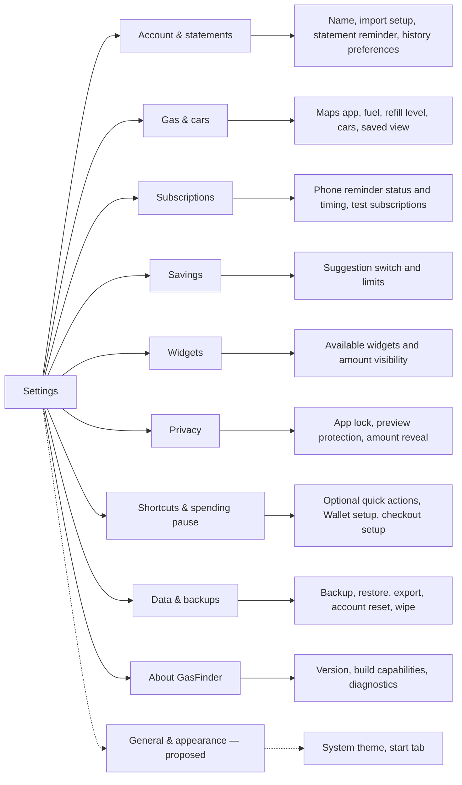
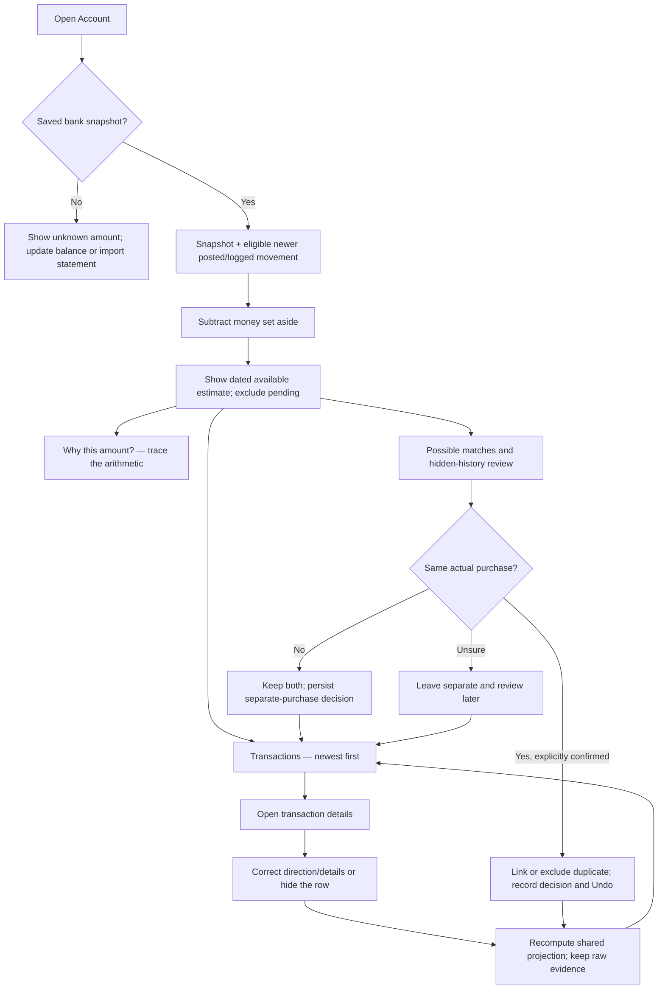
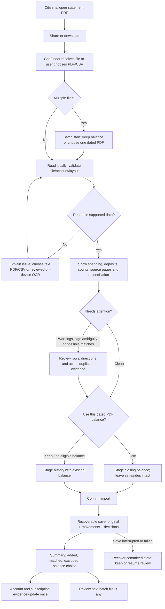
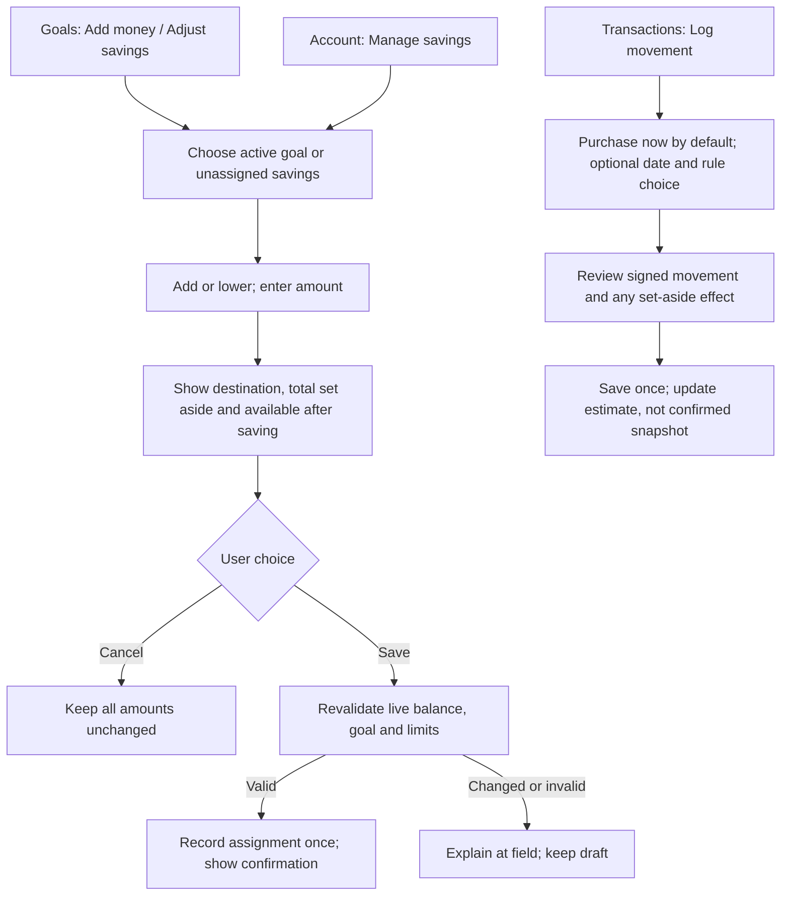
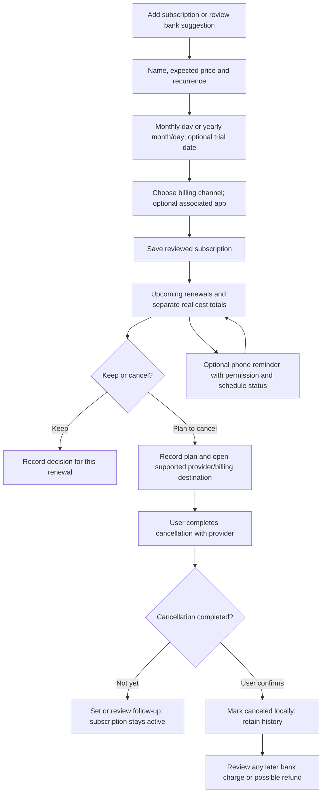
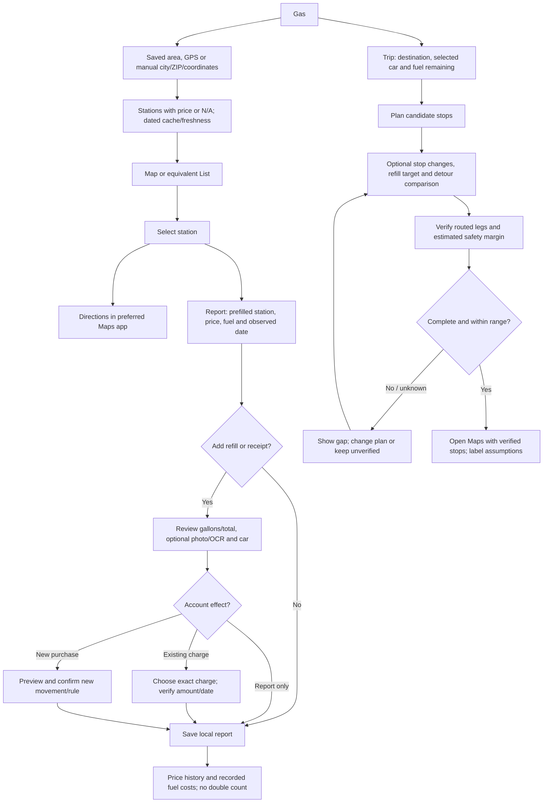
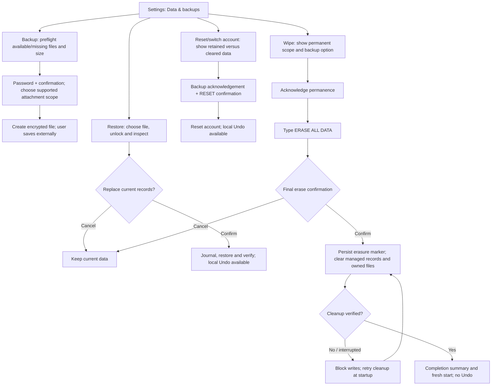

# GasFinder flows and navigation

**October 15, 2026.** These are the **target journeys** for the [final roadmap](../ROADMAP.md), not claims that every branch is already implemented. The [audit](APP_AUDIT_FINAL.md) distinguishes current behavior from proposed changes. Existing safety/reconciliation checks remain in every shortened flow.

## 1. Settings structure

The nine current categories remain the starting point. Controls live inside a category. General & appearance is a proposed tenth category only if its preferences are implemented; it should not be added as an empty destination.

**Rule:** a contextual “Manage reminders” or “Manage test mode” link opens its subsection, not the root list. Returning from a subsection restores the list position. Unavailable native capabilities explain the requirement inside their category.

## 2. Account amount and transaction review

Target for **R01–R05, R10, R25**. The confirmed balance is never silently replaced by a forecast or a duplicate decision.

**Accounting invariant:** hiding affects visibility; matching affects which movements count; savings assignments remain explicit. A bank snapshot absorbs covered activity so it is not subtracted again.

## 3. Citizens statement or CSV import

Target for **R02, R04, R06–R07, R17, R32**. Citizens download/authentication remains in Citizens. Sharing is the shortcut; screen-launcher shortcuts are optional.

**Rules:** mismatch cannot bypass the scanned-PDF gate; clean shared quick import still asks the balance question; an unchanged reimport adds nothing; two legitimate equal charges remain two. Batch setup must be completed before its first commit. Unsaved draft recovery must state exactly what was retained.

## 4. Savings and manual movement

Target for **R03, R06, R17–R18, R28**. A savings change is bookkeeping inside the bank balance.

**Dirty-form rule:** untouched Close is immediate; closing changed input offers Keep editing or Discard. No repeated confirmations for an ordinary small adjustment beyond its clear preview/save boundary.

## 5. Subscription setup, renewal and cancellation

Target for **R09, R11, R17–R18, R24, R33**. App selection is a supported installed-app catalog, not enumeration of every phone app.

**Samples:** test cards can exercise reviews, but real cost totals, bank evidence and phone notifications exclude them. The calendar must provide cancellation follow-up access or a clear direct link to it.

## 6. Gas search, report and drive

Target for **R12, R14, R18–R19, R23, R30, R33**. Price freshness and road evidence remain visible.

**Rule:** navigation support is not proof that a station is open or its pump price current. Edited stops invalidate earlier verification. Basic browsing/search never requires a Shortcut.

## 7. Backup, reset and wipe

Target for **R08, R17, R27, R31**. Different scopes must be visible before confirmation.

**Scope:** external exports/Files/iCloud copies and device lock settings remain. Opening a share sheet is not proof an external backup was saved. Never erase the actual user's data just to accept the flow.
