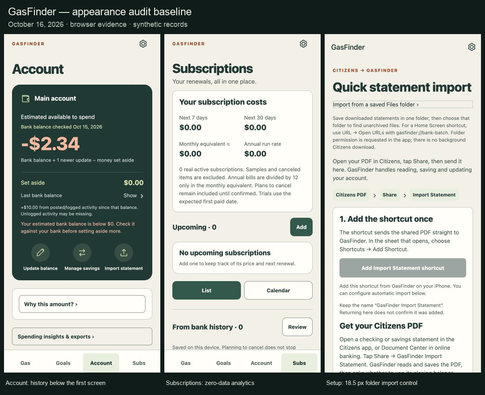

# GasFinder appearance audit

**October 17 follow-up:** The app now has a new shared visual system and Gas Finder layout. See [implementation and verification](GAS_REDESIGN.md). The October 16 findings and captures below remain the historical baseline.

**Date:** October 16, 2026 · **Baseline:** `6ee23b2` · **Scope:** the current private app, including its companion surfaces.

## Verdict

The green, cream and warm orange palette gives GasFinder a recognizable identity. The four-tab structure, prominent available-to-spend amount, quieter bank snapshot, simple import entry and grouped Settings are good foundations.

The app does not yet feel like one finished interface. Its biggest appearance problem is **competing information and controls**: summaries, explanatory text, setup notices and filters frequently occupy the screen before the records someone came to see. Separate button, field, typography and card conventions make secondary screens feel like different generations of the app.

Keep the identity and existing features. Consolidate the shared visual rules, fix the small concrete defects below, and bring transactions, renewals and station comparisons closer to the top. This audit does not recommend a new map engine, a new brand, decorative illustrations or additional feature pages.

**No P0 visual defect was established.** Three local usability defects deserve the first pass, alongside a native appearance configuration check. The development-only history warning should also be removed. The remaining findings are finish work, rather than evidence that the underlying financial features are absent.

## Evidence and limits

- **Observed:** rendered in the browser, with screenshots. **Measured:** read-only DOM bounds or calculated source-color contrast. **Source:** code inspection; no claim of a native reproduction. **Recommendation:** a design judgment. **Device gate:** requires an installed phone or companion surface.
- Main viewport: **390 × 844 CSS pixels**. Narrow checks: **320 × 844**. Wide checks: **1024 × 844**. Light and dark themes were exercised; bolder text, stronger contrast and larger controls were also exercised on narrow screens.
- The audit used the separate `127.0.0.1:8087` browser origin. Existing account figures were synthetic; the only new financial fixtures were the built-in invented subscriptions, removed afterward. Public Boston city-center coordinates supplied real station results; no personal GPS location was granted. There were no saved purchases, bank uploads, provider cancellations, reset/wipe/restore actions or real financial changes.
- Appearance was returned to System; temporary accessibility switches were returned to off; subscription and gas views were returned to List. The isolated origin retains public station search/cache data. The existing `localhost` preview was left intact, and the temporary viewport/tab were removed.
- This is **not** physical iPhone/Android acceptance, a full screen-reader certification, a native Dynamic Type test, or a review of every possible populated financial state. Native keyboard, status bar, safe areas, system sheets, widgets and installed extension rendering remain explicit gates.
- [Screenshot gallery](style-audit-2026-10-16/index.html) · [capture index](style-audit-2026-10-16/README.md) · [literal style inventory](style-audit-2026-10-16/style-inventory.json). Screenshots show the unchanged baseline, not proposed redesigns. Some capture names describe the screen rather than every active fixture; the index identifies loading and sample states.

## First fixes

| ID | Priority | Finding | Evidence | Acceptance |
| --- | --- | --- | --- | --- |
| **V01** | P1 / small | Saved-folder import looks like an unstyled text strip | Observed + measured + source | A normal padded control, at least the shared target height, including Larger controls |
| **V02** | P1 / medium | Subscription calendar remains too narrow and ignores Larger controls | Observed + measured + source | Usable narrow layout and explicit larger targets; no compressed seven-column controls |
| **V03** | P1 / medium | Several populated fields lose their visible labels and units | Observed + source | Persistent labels for dates, prices, passwords and financial amounts |
| **V04** | P1 / small + device | System appearance conflicts with native configuration | Source; native effect unverified | Installed System follows OS appearance; explicit Light/Dark still work |
| **V05** | P2 / small | Full transaction history emits a developer rendering warning | Observed + source inference | No unexpected-text warning with an empty date range |

### V01 — Saved-folder import is only 18.5 pixels tall

In [Quick statement import](style-audit-2026-10-16/statement-setup-light.png), “Import from a saved Files folder ›” is a thin outlined strip. At 390 pixels wide, its rendered bounds were **350 × 18.5**. The other controls on the same page are properly padded.

`src/app/statement-automation.tsx:59` applies `styles.secondary` without `styles.button`. The secondary style supplies only background and border; the base supplies height, padding, alignment and radius. Apply the full shared control treatment. Verify both the normal and Larger controls preferences; changing the color alone will not fix this.

### V02 — Subscription calendar does not adapt to narrow screens

Day cells measured **35.14 × 48** at 320 pixels, both with and without Larger controls. This is smaller than the app's shared touch-target goal; the preference is not delivering its expected larger target here. The “1 due” label is also set to 10-point text.

`src/features/subscriptions/SubscriptionCalendar.tsx:19` uses inline `width: '14.2857%'` and `minHeight: 48`. It bypasses the transformed shared styles. The newer generic date field already has adaptive behavior; the subscription calendar needs a compatible strategy, such as an agenda/day selector at narrow widths, rather than squeezing seven interactive columns inside a padded card. Preserve month navigation, selected-day context and the List option.

Evidence: [normal 320-pixel calendar](style-audit-2026-10-16/subscription-calendar-320.png), [larger-control dark calendar](style-audit-2026-10-16/calendar-dark-larger-320.png). Do not characterize every sub-44-pixel control as an automatic WCAG violation; the measured mismatch with this app's target and preference is the finding.

### V03 — Field identity should survive typing

The [Insights date fields](style-audit-2026-10-16/insights-light.png) display two ISO dates without persistent visible From/Through labels. [Fuel report fields](style-audit-2026-10-16/fuel-report-light.png) and [backup passwords](style-audit-2026-10-16/backup-light.png) also rely on placeholders for some field identity. Accessible labels exist, but they do not provide visible context after entry.

Use the persistent label/error pattern already present in the [subscription editor](style-audit-2026-10-16/subscription-editor-light.png). Keep currency, per-gallon, mileage and percentage units visible. Place examples in helper text, not as the only label. Sources: `src/app/insights.tsx:46`, `src/app/backup.tsx:37`, `src/app/report-price.tsx` and their field components. Include expanded history filters in this sweep.

### V04 — System theme has a native configuration conflict

`app.json:9` sets `userInterfaceStyle` to `light`, while Settings offers System and `AppearanceBridge` reads the OS scheme. Expo's SDK 57 configuration documentation describes `light` as forcing light appearance and `automatic` as following the system. This is a source-level conflict with the intended setting. Explicit JavaScript Dark rendered correctly in the browser; this audit did not reproduce the installed-phone behavior. [Expo SDK 57 app configuration](https://docs.expo.dev/versions/v57.0.0/config/app/)

Verify the resolved native configuration and an installed device in both OS schemes. Resolve the configuration through app config/prebuild, with platform-specific support checked against SDK 57 docs. Then check status/navigation bars, keyboard, pickers and sheets as well as the React content. Do not hand-edit generated native files or claim this is closed from a web screenshot.

### V05 — Transaction history shows a development warning

[Full history](style-audit-2026-10-16/history-light.png) produced “Unexpected text node: . A text node cannot be a child of a <View>.” in the development preview.

The likely cause is `src/app/account-transactions.tsx:52`: `(from || to) && <Text …>` evaluates to an empty string with no selected range. Use an explicitly boolean conditional and verify the empty, preset and cleared range states. This was a browser development warning; a production native crash was not established.

## Main-screen hierarchy

These are **P2 design recommendations**, supported by observed layouts. Preserve important qualifications and financial distinctions while reducing their repetition.

### V06 — Account spends too much of the first screen on its balance panel

The [light Account capture](style-audit-2026-10-16/account-light.png) has an approximately 488-pixel hero, followed by separate explanation/Insights cards. Transactions are below the first 844-pixel viewport. The synthetic negative balance adds a legitimate warning, so this is a stress state rather than a claim that every account has identical height. The renewal banner makes the same issue more pronounced in [dark mode](style-audit-2026-10-16/account-dark.png).

Keep the main available-to-spend figure dominant, the snapshot date visible and the actual bank balance behind its existing Show control. Compact the formula, reserve and newer-activity details into a smaller supporting group. Put the transaction list immediately after the balance/actions. Make “Why this amount?” and Insights quiet supporting entries rather than large intervening surfaces. Keep overdraft, stale/unknown balance and incomplete-evidence notices when relevant.

Primary sources: `src/app/(tabs)/pocket.tsx`, `src/features/pocket/BalanceExplanation.tsx` and `MoneyPage`.

### V07 — Subscriptions prioritizes analytics over subscriptions

The [empty page](style-audit-2026-10-16/subscriptions-empty-light.png) shows four zero-valued metrics and a long methodology paragraph before its main empty state. With samples enabled, [test notices, costs and reminder controls](style-audit-2026-10-16/subscriptions-samples-light.png) push renewal cards off the first screen. Test mode is optional; its extra banner is not present for everyone, but the cost summary remains substantial without it.

Lead with the next renewal/upcoming list and one useful cost headline. Put equivalent/annual calculations and methodology behind a small breakdown/info action. Collapse zero-data analytics until a real service exists. Keep samples unmistakably labeled and excluded from real totals. Use one calm Add action and consistent card actions; repeated filled “Plan to cancel” buttons should not visually dominate normal service management.

Sources: `src/app/(tabs)/subscriptions.tsx`, `SubscriptionCosts.tsx`, `SubscriptionsPanel.tsx` and `SubscriptionButton.tsx`.

### V08 — A global renewal notice overwhelms unrelated tabs

The two-button renewal banner occupies roughly **118 pixels** above the main content on each tab. On [Goals](style-audit-2026-10-16/goals-for-editor-light.png), the page title is displaced substantially by a task from another section. This occurred with invented sample renewals, explicitly labeled as such; it is still a valid preview of the banner layout.

Use a compact notice with a clear Review action and quieter snooze. Expand the explanation within the review flow. Keep overdue/urgent status legible, and avoid repeatedly presenting two equally prominent full-width buttons on every page. Source: `PageToolbar` / `RenewalBanner`.

### V09 — Station cards make comparison slow

The [loaded station list](style-audit-2026-10-16/gas-station-card-dark.png) uses roughly a third to half a phone screen per station: name/address, distance, unavailable-price prose, attribution, Save, Maps, report and history. A result set of 100 stations becomes a long series of action panels. The cost of the layout remains even when no prices are known.

Make the comparison row compact: station/address, distance, prominent price or N/A, freshness/payment qualifier, favorite and one directions action. Put report/history in an expanded detail area. Keep legally required attribution accessible and legible; review provider requirements before consolidating it. Do not remove the user's report or history features. Align unavailable wording between List and Map.

Sources: `GasStationCard.tsx` and `src/app/(tabs)/index.tsx`. Public station results loaded successfully; no fabricated prices were inserted.

### V10 — Full-history filters dominate the history

In [Transactions](style-audit-2026-10-16/history-light.png), manual logging, review, search, direction chips, date chips, another advanced-filter action and counts precede the first record. The first record begins around 620 pixels down. Both “Custom dates” and “Date, category & source filters” open the same advanced area.

Use search plus one Filters control, concise active-filter chips and a count. Keep date presets inside the filter area or a compact single row. Keep Log and Review reachable without giving each a separate large block. The footer “See full history” on Account is already the requested pattern; preserve it. Source: `src/app/account-transactions.tsx`.

### V11 — Empty states vary from clear to overbuilt

[Goals](style-audit-2026-10-16/goals-empty-light.png) offers a focused empty state. Subscriptions shows zero analytics; [Account review](style-audit-2026-10-16/account-review-light.png) shows several zero-count sections; [Saved imports](style-audit-2026-10-16/saved-imports-light.png) presents library controls before any file exists. [Fuel reports](style-audit-2026-10-16/fuel-library-dark.png) says “No matching reports” even in a pristine library, which implies an unsuccessful search.

Use a consistent empty-state pattern: what belongs here, one next action, optional help. Show search/sort/filter/history controls when there is something to manage, while preserving access to Trash/recovery when it contains data. Distinguish “Nothing saved yet,” “No matches” and “Nothing needs review.” The minimal bank file chooser is intentional and good; keep it minimal.

### V12 — Backup/setup pages need more readable disclosure

[Backup](style-audit-2026-10-16/backup-light.png) nests a sizable data-health block inside the create-backup task, pushing the main action below the initial viewport. [Account reset](style-audit-2026-10-16/account-reset-dark.png) presents important but dense paragraphs. [Statement setup](style-audit-2026-10-16/statement-setup-light.png) repeats the PDF journey in its introduction, path, installation instructions and send-next-statement section.

Use short “what happens” summaries, concise health counts and expandable details. Keep password requirements, recovery limitations and destructive-action consequences visible at the decision point. In statement setup, distinguish the primary Share journey from the Files-folder alternative and put troubleshooting behind the existing help disclosure. This is a copy/layout pass, not permission to remove confirmations or automate bank sign-in.

Sources: `backup.tsx`, `account-data.tsx`, `statement-automation.tsx` and data-health components.

## Shared visual system

### V13 — Buttons do not have consistent visual roles · P2

Primary actions can be green, dark ink or orange, with 6-, 7-, 8- or 10-pixel radii and 46/48/50-pixel minimum heights. Some secondary actions are outline buttons, some are colored text, and others are full cards. The [goal editor](style-audit-2026-10-16/goal-editor-light.png), [subscription editor](style-audit-2026-10-16/subscription-editor-light.png), [fuel report](style-audit-2026-10-16/fuel-report-light.png) and [backup](style-audit-2026-10-16/backup-light.png) make this difference visible.

Define shared **Primary, Secondary, Quiet and Destructive** roles with consistent normal/pressed/focused/busy/disabled states. Reserve a filled primary action for the current task. Keep destructive confirmation adjacent and clearly named. Selected chips are selection controls, not a separate kind of primary action. Consolidate existing components rather than adding another screen-specific button helper.

Sources: `SubscriptionButton.tsx`, `src/features/data/styles.ts`, `GoalEditor.tsx`, bank and gas button helpers.

### V14 — Type hierarchy is fragmented; supporting text is often too small · P2

The literal inventory found **27 font-size values across 324 declarations**, including icons and financial display sizes. This does not mean there are 27 body styles, but it indicates many local decisions. It includes 23 declarations at 11, 63 at 12 and 76 at 13. Important caveats and setup instructions often use those small sizes. Goal fields use 11-point uppercase labels with letter spacing, while subscription fields use clearer 15-point sentence-case labels.

Use a small semantic scale: page title, section title, body, supporting text, field label and financial display. As a starting design target, use 15–16 for normal reading, 13–14 for secondary copy and 30–34 for page titles, with adaptive financial figures. Validate these choices on device; preserve font scaling and wrapping. Do not force required map attribution into the normal body role or shrink long text to make it fit.

Sources: `src/theme.ts`, `src/features/data/styles.ts`, form styles and [inventory](style-audit-2026-10-16/style-inventory.json).

### V15 — Spacing, corners and nested surfaces lack a clear rule · P2

The same inventory contains **16 radius values**, 17 padding values and 17 gap values. Some are justified by circles, pills and charts; the ordinary card/control differences are less consistent. Account explanations and backup health combine card-within-card borders, while other screens use a single flat panel.

Adopt a shared spacing scale, keep the existing approximately 20-pixel phone gutter, and distinguish ordinary cards, deliberate hero panels, controls and pills. A reasonable starting point is a 12-pixel regular card, a larger hero radius and 8–10-pixel controls. Remove redundant surface wrappers before adjusting every border. Apply the roles across screens; do not mechanically replace every radius literal.

### V16 — Navigation symbols and headers send mixed signals · P2

The app mixes SVG icons with text glyphs such as `›`, `⌄`, `↗`, stars and plus signs. The external-link arrow appears on internal destinations such as Gas on your drive and saved price history, as well as genuine Maps/browser handoffs. Trip planning also exposes an in-body Settings link in addition to the universal header gear. Secondary pages alternate between generic “GasFinder” headers and route-specific titles, often followed by another large title.

Use the existing icon family and consistent icon sizing/stroke. Use a chevron for internal navigation, an expand indicator for disclosure and an external arrow when leaving the app. Keep one universal Settings entry per screen. Define one header pattern for main tabs and one for pushed screens; retain a useful content heading when it adds context, rather than repeating identical titles by default. Validate native Back and screen-reader headings before removing elements.

Sources: `SettingsButton.tsx`, `_layout.tsx`, `on-route.tsx:179`, station/goal links and shared headers.

### V17 — Some selected states are too subtle · P2

The pale-green selected fill differs from its surface by about **1.17:1 in light mode** and **1.31:1 in dark mode**. This affects low-emphasis active states such as the bottom tab treatment and selected calendar day. Some also change text color/weight; that additional information matters, so this is not a blanket contrast-failure claim. Stronger contrast currently changes muted text/borders, not this fill pair.

Add an unmistakable selected cue, such as an underline, stronger boundary or check, alongside the fill. Ensure keyboard focus and selected state remain distinguishable. Keep money-in/out signs and words; the app already provides those and should not regress to color-only meaning.

Sources: `src/theme.ts`, `BottomNavigation.tsx`, `SubscriptionCalendar.tsx`.

### V18 — Map chrome remains a light island in dark mode · P2

The [dark Gas map](style-audit-2026-10-16/gas-map-dark.png) retains light tiles and white map overlays/controls. `station-map.css` uses hardcoded light colors. The theme transition is conspicuous next to dark app panels; a small 10-point legend also carries important price/sample meaning.

Keep Leaflet/OpenStreetMap as requested. Theme the surrounding map controls, messages, pins and legend first. Keep N/A, Old and sample qualifiers explicit and readable. A different free tile style would require a separate provider/usage/attribution review; it is not necessary to fix the app chrome and is not presumed free at every usage level. Do not apply a blanket inversion filter that distorts map semantics.

### V19 — Loading counts look like final empty results · P2

The [initial gas capture](style-audit-2026-10-16/gas-list-light.png) and [search-in-progress capture](style-audit-2026-10-16/gas-search-loading-dark.png) show “0 stations” while the page is still locating/searching. Search later returned 100 stations. The [price-history capture](style-audit-2026-10-16/price-history-loading-dark.png) also shows a loading state, not an accepted empty chart.

Render “Searching…” or an unknown count while waiting, and distinguish never searched, loading, cached-and-refreshing, final empty and failed states. Existing cache/source notices are useful; shorten repetitive text while retaining timestamps. Use stable layout to avoid result jumps. Do not show zero as a substitute for unknown data.

### V20 — Tablet/web content stretches without a readable limit · P2

At 1024 pixels, [Settings](style-audit-2026-10-16/settings-wide-dark.png) rows and [Account](style-audit-2026-10-16/account-wide-dark.png) panels span almost the entire viewport. Text and trailing actions become disconnected, and the same phone composition occupies a very wide single column. `ios.supportsTablet` is enabled, so this is relevant beyond a desktop preview, although native iPad rendering was not tested.

Constrain reading/forms to a centered maximum width. Consider a separate wide map/list arrangement only where it helps comparison. Keep main navigation and touch targets usable without scaling phone text up to fill space. Test both iPad orientations before claiming tablet polish. Sources: `MoneyPage.tsx`, `SettingsPage.tsx`, app config and page containers.

### V21 — Companion surfaces have separate theme rules · P2 / source + device

The Account widget explicitly adapts its title color to `environment.colorScheme`; the Goal widget title hardcodes dark green. The extension popup declares `color-scheme: light` and uses its own slightly different cream and border colors. These are source findings, not captured widget or installed-browser defects.

Make goal-widget colors work in supported light/dark/tinted contexts, and share a small set of visual roles with the popup. Respect widget-family constraints, privacy masking and system accessibility. Test the actual widget sizes and supported browser popup before accepting changes. The icon's dark-green/orange/white identity is coherent and can stay. Sources: `src/widgets/GoalProgressWidget.tsx:27`, `AccountWidget.tsx` and `extensions/spending-pause/popup.css`.

## Contrast and accessibility assessment

The recent accessibility work is visible and should be retained: dedicated preferences, stronger control boundaries, larger shared targets, readable field errors, screen-reader labels, transaction signs/direction text and keyboard-aware dates/tabs. The old muted-text issue is **not** carried forward as an unfixed defect.

Calculated from the current theme tokens:

| Pair | Ratio | Interpretation |
| --- | --- | --- |
| Light muted `#52675D` on paper `#F4F0E7` | **5.34:1** | Above the 4.5:1 normal-text threshold |
| Light muted on surface `#FFFEF9` | **6.02:1** | Above that threshold |
| Dark muted `#B1C4B7` on surface `#192A25` | **8.18:1** | Strong text separation |
| Light input boundary `#7A8C7D` on surface | **3.54:1** | Useful control boundary separation |
| Light decorative card line on surface | **1.73:1** | Not every card outline conveys required control information |
| Pale selected fill on surface | **1.17:1 light / 1.31:1 dark** | Needs assessment with its other selection cues; see V17 |

These are token calculations, not certification of every rendered element, overlay or image. WCAG text contrast uses 4.5:1 for ordinary text and 3:1 for qualifying large text; meaningful non-text control/state cues have their own 3:1 rule. Decorative borders are not all required to meet it. [Text contrast](https://www.w3.org/WAI/WCAG22/Understanding/contrast-minimum.html), [non-text contrast](https://www.w3.org/WAI/WCAG22/Understanding/non-text-contrast.html).

Remaining visual accessibility checks:

- Largest native text sizes with long merchant/service/goal names and large or negative monetary values; wrapping must not hide controls or change financial meaning.
- VoiceOver/TalkBack focus order, modal focus return and concise status/error announcements on actual devices. This audit reviewed visible labels/states, not spoken output.
- Controls with Larger controls enabled, including inline-style calendar/map/extension exceptions.
- Distinct focus, selected, pressed and disabled appearances; keyboard focus must not be clipped by card/scroll containers.
- Status bar and notch/home-indicator safe areas, keyboard avoidance and native sheet contrast in both OS schemes.
- Reduced motion in the embedded map and native presentations; browser preference behavior alone is insufficient.

See [existing accessibility acceptance](ACCESSIBILITY.md) and [Apple typography guidance](https://developer.apple.com/design/human-interface-guidelines/typography). These device gates remain open after this audit.

## Screen coverage

| Surface | Rendered coverage | Assessment / linked findings |
| --- | --- | --- |
| Gas | Initial/loading List, public results, station cards, Map/dark | Retain existing engine; compact comparison, theme chrome, distinguish counts: V09, V18, V19 |
| Goals | Empty state, new-goal sheet | Clear empty action; field/type/button mismatch: V13–V15. Populated progress/archive source-reviewed only |
| Account | Synthetic negative estimate, newer refund, Show control, dark/wide | Financial hierarchy is sound; vertical layout is heavy: V06, V08, V20 |
| Subscriptions | Empty, invented list cards, expanded actions, invalid editor, narrow calendar, dark | Consistency better inside the editor than across pages: V02, V07, V08, V13 |
| Settings index | Light, dark/wide; search present | Grouped subsections are the correct structure; readable width/header rhythm: V16, V20 |
| General & appearance | Light, dark, System preference | Coherent palettes; native System configuration check: V04 |
| Accessibility | Light and 320-pixel dark with three options enabled | Useful preferences; inline calendar exception: V02, V17 |
| Account & statements | Category screen and setup entry | Keep brief, with one setup destination; V12 |
| Gas & cars | Category screen and empty car library | Good separation of preferences and records; normalize control treatment: V13 |
| Subscriptions settings | Phone reminder unavailable state, sample controls | Keep capability explanation and explicit sample state; shared row style: V13–V15 |
| Savings settings | Toggles/rule controls | Keep optional controls here; normalize settings rows: V13–V15 |
| Widgets settings | Capability/setup explanation | Native gallery not rendered; V21 and device gates |
| Privacy settings | Cover and settings controls | Cover keeps data hidden; avoid changing protection while styling. Native app-switcher acceptance remains |
| Shortcuts & spending pause | Category screen and pause setup | Explanatory density and internal/external icon consistency: V12, V16 |
| Data & backups | Category, Backup, reset entry | Keep recovery/destructive distinctions; readable disclosure/labels: V03, V12 |
| About | Version/capability explanation | Use same title, paragraph and divider rules; V14–V16 |
| Transactions | One synthetic record, default filters, developer warning | V03, V05, V10; no real records deleted |
| Account review | Nothing-to-review state | Simplify zero sections; V11. No match decisions changed |
| Bank import / Saved imports | Minimal chooser, empty archive | Chooser is good; library empty state can simplify: V11 |
| Statement quick import | Web-disabled shortcut, account preferences, help entry | V01, V12; actual Share sheet/Shortcut not executed |
| Fuel report / library | Unsubmitted form, empty library | V03, V11, V13; no photo picked or report saved |
| Price history | Loading capture, source review of chart/empty states | V14, V19; no populated chart visual acceptance |
| Trip planning | Unsubmitted destination/car/tank form | Keep numbered progression; duplicate Settings and header density: V16 |
| Amazon goal | Unsubmitted lookup entry | Keep lookup/goal connection; consistent fields/buttons: V03, V13 |
| Quick setup | Optional checklist | Clear optional nature; shorten repeated prose: V12 |
| Widgets / extension / launch assets | Source/assets only | V21; actual Home Screen, popup, splash and first-frame acceptance open |

Batch/folder picker, purchase capture/automation handoff, restored/imported record detail, OS file/share sheets, populated car statistics, receipt/OCR, goal completion, destructive confirmations and every cancellation follow-up state were **not independently rendered in this appearance pass**. Their shared styles/source were reviewed where relevant; existing functional documentation is not treated as visual proof. Retired routes are not new navigation recommendations.

## Proposed shared appearance contract

This is a starting specification for the implementation pass, not an implemented redesign:

| Element | Rule |
| --- | --- |
| Main page | One page heading; core record/decision visible early; setup/help behind supporting entries |
| Secondary page | Consistent Back/title/Settings header; content title adds context instead of automatic repetition |
| Color | Retain semantic green/cream/orange palette; use danger for destructive/error states; verify all themes |
| Type | A small named type scale; sentence-case field labels; tabular money; supporting copy still comfortable to read |
| Controls | One role-based button component, selected chip treatment and settings row; normal and larger target sizes |
| Fields | Persistent visible label, unit where relevant, helper/error association and preserved entered value |
| Surfaces | One ordinary card and one deliberate hero treatment; avoid redundant nested borders |
| Density | Compact record rows, expandable details, concise non-blocking notices; never remove material financial context |
| States | Explicit empty/loading/cached/error/disabled/success/selected/focused appearances |
| Width | Phone gutters preserved; centered readable form width on larger screens |
| Icons | Shared icon family; internal, external and disclosure directions have distinct meanings |

Suggested Account order:

```mermaid
flowchart TD
  A[Toolbar and Account title] --> B[Available to spend and snapshot date]
  B --> C[Set aside and quieter bank balance Show]
  C --> D[Balance, savings and import actions]
  D --> E[Transactions, newest first]
  E --> F[See full history]
  B -. supporting detail .-> G[Why this amount and Insights]
```

Warnings that change how the amount should be understood stay adjacent to it. The diagram is a hierarchy proposal, not a change to balance calculations, consent or transaction sorting.

## Implementation order and sign-off

1. **Small defects:** V01, V05; confirm V04 on device and resolve configuration if reproduced. Fix persistent labels and the narrow calendar (V02–V03).
2. **Shared primitives:** V13–V17. Start with buttons, fields, settings rows and title/spacing roles; migrate page families incrementally. Preserve draft state, focus, accessibility and theme subscriptions.
3. **Daily pages:** V06–V10, using the shared components. Verify useful first-screen content with and without renewal notices, unknown/negative balances, sample mode and long names.
4. **Empty/help/recovery:** V11–V12 and V19. Retain all recovery/destructive safeguards while shortening presentation.
5. **Map, wide and companion finish:** V18, V20–V21; keep provider/entitlement constraints explicit.
6. **Physical acceptance:** installed iPhone first, then supported Android/iPad/extension/widget surfaces. Check safe areas, keyboard, largest text, VoiceOver/TalkBack, reduced motion and cold launch. Keep R31–R34 open until their separate requirements pass.

Before closing a visual ticket: capture its normal, dark and 320-pixel layouts; check the relevant larger-control/text state; verify meaningful empty/error/busy states; run lint and TypeScript. Use focused behavioral checks when a visual change touches interaction. A screenshot cannot prove import correctness, recovery safety or a successful provider cancellation.

**Audit delivery:** documentation and captured evidence only; no application source, native configuration, dependencies or financial logic changed. `npx expo lint` and `npx tsc --noEmit` were run for this documentation batch; outcomes are recorded in the handoff.
